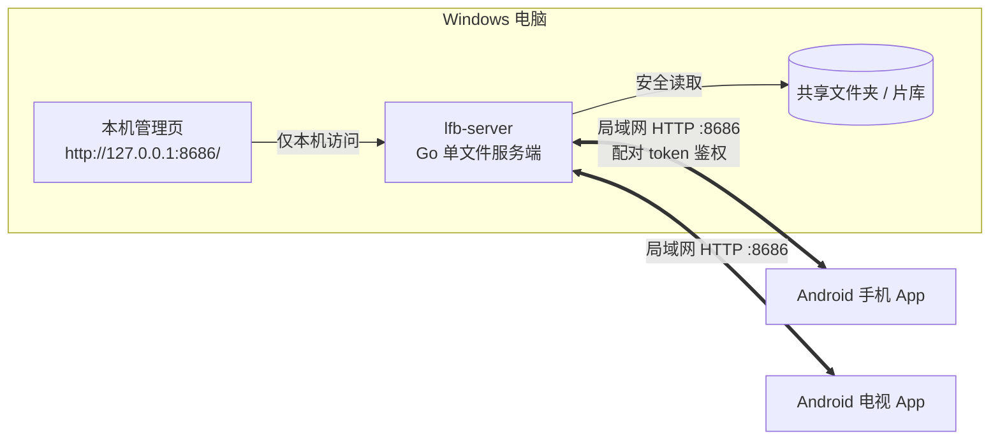

# LAN File Browser

局域网文件浏览器：电脑共享文件夹，手机 / 电视在同一局域网内直接浏览、播放视频、查看图片——不上传云端、不转码。

> **项目状态**：P1 服务端与本机管理页已实现；P2 进行中（数据库、剧集识别、防睡眠等地基已完成，相关接口尚为占位）；Android 手机 / 电视 App（Flutter）尚在开发，暂无可安装版本。

## 功能亮点

| 功能 | 说明 | 状态 |
| ---- | ---- | ---- |
| 局域网浏览 | 电脑上选择共享文件夹（片库），按设备设置可见范围与下载权限；手机扫码 / PIN 配对后浏览 | 服务端已实现，App 开发中 |
| 视频边下边播 | HTTP Range 流式传输，原画不转码不压缩，可任意拖动；播放期间阻止电脑睡眠 | 服务端已实现，App 开发中 |
| 自动下一集 | 同目录按文件名自然排序，识别 `E01`、`第01集` 等集号 | 剧集识别已实现，`/api/next` 接口 P2 进行中 |
| 图片查看 | 左右滑动切换、缩放；缩略图 | 规划中（P2） |
| 观看进度 / 继续观看 | 断点续播、继续观看列表 | 规划中（P2） |
| 加密片库 | 密码锁定的片库，锁定时在设备上完全隐藏 | 设计完成，规划中（P2） |
| 自动整理 | 定时把下载目录中的新视频 / 图片复制或移动到片库并自动归类 | 设计完成，规划中（P2） |
| 电视端 | Android 电视 / 盒子，遥控器操作 | 设计稿完成，App 开发中 |
| 局域网自动发现 | App 免输 IP 找到电脑 | 服务端已实现（UDP 8687），App 开发中 |

平台：服务端仅 Windows；客户端仅 Android（手机与电视），不做 iOS。

## 工作原理



- 电脑端运行服务端，在本机管理页添加片库、生成配对码、管理已配对设备。
- 手机 / 电视通过 PIN 或扫码与电脑配对，之后凭 token 访问文件列表与文件流；视频由播放器按 Range 请求边下边播。
- 所有文件访问都限制在共享文件夹内（路径校验 + `os.Root`），不可见的片库与“不存在”返回同样的 404。

## 快速开始

### 从源码运行服务端

需要 Windows 与 **Go 1.25 或更高版本**（服务端依赖 `golang.org/x/sys/windows`，只能在 Windows 上编译）。

```sh
git clone https://github.com/tongxin-77/lan-file-browser.git
cd lan-file-browser/server
go run ./cmd/server -data devdata
```

- `-data` 指定数据目录（配置、设备、`data.db`），省略时为 `%APPDATA%\LanFileBrowser`；`-port` 指定端口，默认 8686。
- 启动后在本机浏览器打开 <http://127.0.0.1:8686/> 管理页，添加片库（共享文件夹）并查看配对码。管理页只允许本机访问。
- 首次运行时 Windows 防火墙可能询问是否允许局域网访问，需允许后手机才能连接。

构建单文件可执行程序：

```sh
cd server
go build -o dist/lfb-server.exe ./cmd/server
```

### 手机 / 电视端

Flutter App 尚在开发，暂未发布。发布后将在 GitHub Releases 提供 Windows 安装包与 Android APK（见 [02-release](docs/02-release.md)）。

## 目录结构

```
lan-file-browser/
├── server/                    # Go 服务端（module lfb/server）
│   ├── cmd/server/            # 程序入口（-data 数据目录、-port 端口）
│   ├── internal/
│   │   ├── api/               # HTTP 路由、鉴权与本机 / CSRF 中间件、统一错误码
│   │   ├── auth/              # 设备配对（PIN / 一次性码）、token 存储
│   │   ├── config/            # config.json 读写（不可变快照 + 原子更新）
│   │   ├── fsx/               # 共享目录内的安全文件访问（os.Root）、隐藏项
│   │   ├── listing/           # 目录列表自然排序
│   │   ├── media/             # 媒体类别与 MIME 判定
│   │   ├── episode/           # 剧集 / 集号识别
│   │   ├── activity/          # 活跃播放跟踪、播放时阻止系统睡眠
│   │   ├── store/             # SQLite（data.db）与迁移
│   │   ├── web/               # 内嵌本机管理页（原生 HTML/CSS/JS）
│   │   └── discovery/         # 局域网自动发现（UDP 8687 应答）
│   ├── configs/               # 配置示例（尚为空）
│   └── installer/             # Inno Setup 安装包脚本（尚为空）
├── app/                       # Flutter App（尚在初始化，目前只有 lib/ 目录骨架）
├── docs/                      # 设计文档 01–07
│   └── desgin/                # 设计稿、图标与选型记录（目录名保持原拼写）
├── .githooks/                 # pre-commit（格式检查）、commit-msg（提交信息校验）
└── .github/workflows/         # CI / Release 工作流（尚未创建）
```

## 设计文档

| 文档 | 内容 |
| ---- | ---- |
| [01-connection](docs/01-connection.md) | 手机 / 电视如何发现、配对、连上电脑，token 与断线重连 |
| [02-release](docs/02-release.md) | 版本策略、CI、GitHub Release、安装包、自动更新 |
| [03-file-api](docs/03-file-api.md) | 文件浏览接口、路径安全、权限、错误码、观看进度 |
| [04-vault](docs/04-vault.md) | 加密片库（密码锁，锁定时完全隐藏） |
| [05-playback](docs/05-playback.md) | 播放速度与稳定性（不压缩、防睡眠、断线续播、缓存、预加载下一集） |
| [06-organizer](docs/06-organizer.md) | 自动整理：按片库设置源文件夹，定时复制 / 移动并自动归类 |
| [07-notes](docs/07-notes.md) | 注意事项：待验证测试、已接受风险、后续实现须知、构建环境 |
| [desgin/DECISIONS](docs/desgin/DECISIONS.md) | 已选定的界面设计稿（管理页、手机、电视）与 App 图标 |

## 开发

服务端（在 `server/` 下执行）：

```sh
gofmt -l .                  # 应无输出
go vet ./...
go test -count=1 ./...
```

- 符号链接相关测试需要 Windows 开发者模式或管理员终端；`-race` 需要 cgo 与 gcc（见 [07-notes](docs/07-notes.md) §1）。
- 开发约定（安全规则、配置并发、数据库迁移编号等）见 [CLAUDE.md](CLAUDE.md)。

### 提交规范

提交信息使用 [Conventional Commits](https://www.conventionalcommits.org/zh-hans/)，描述用中文，首行不超过 72 字符：

```
<type>(<scope>): <描述>

feat(server): 添加缩略图接口
docs: 完善 README
```

- type：`feat` `fix` `docs` `style` `refactor` `perf` `test` `build` `ci` `chore` `revert`
- scope（可省略）：`server` `app` `web` `docs` `design` `release` `ci`
- 提交前须通过格式化检查与测试。

### Git hooks

首次克隆后启用仓库自带的 hooks：

```sh
git config core.hooksPath .githooks
```

- `pre-commit`：暂存区有 `.go` 文件时运行 `gofmt -l` 检查；Flutter 工程存在且暂存了 `.dart` 文件时运行 `dart format` 检查。
- `commit-msg`：校验提交信息首行格式。

## 路线图

- **P1（已完成）**：服务端单 exe；本机管理页（片库、可见设备与权限、配对码、设备管理）；设备配对与 token 鉴权；目录列表、文件下载、视频 Range 流；路径安全与隐藏项处理。
- **P2（进行中）**：App 浏览与视频播放、自动下一集、字幕、图片查看、缩略图、观看进度与继续观看、加密片库、自动整理、测速与播放稳定性增强。
- **P3（规划）**：局域网自动发现（服务端已提前实现）、上传 / 重命名 / 删除（回收站）、目录变更实时推送、跨季下一集、可选硬件转码。

## License

[Apache License 2.0](LICENSE)，见 LICENSE。
