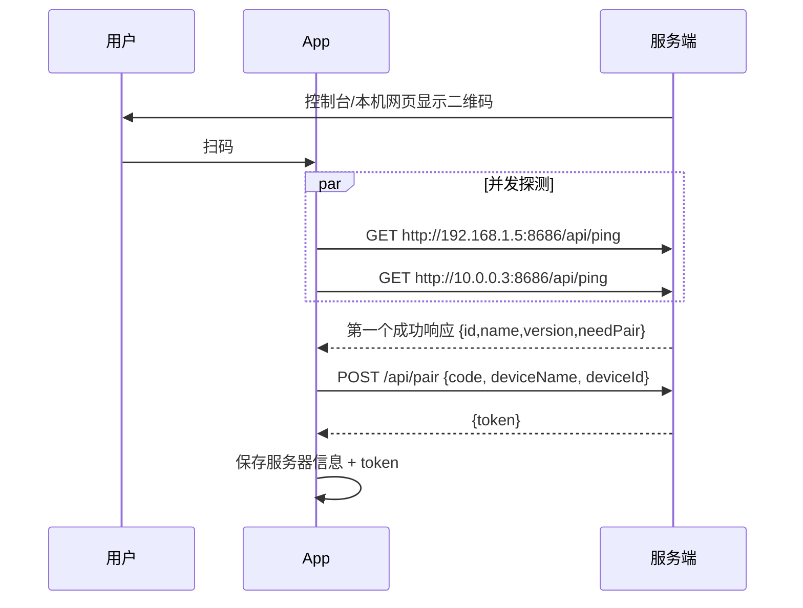
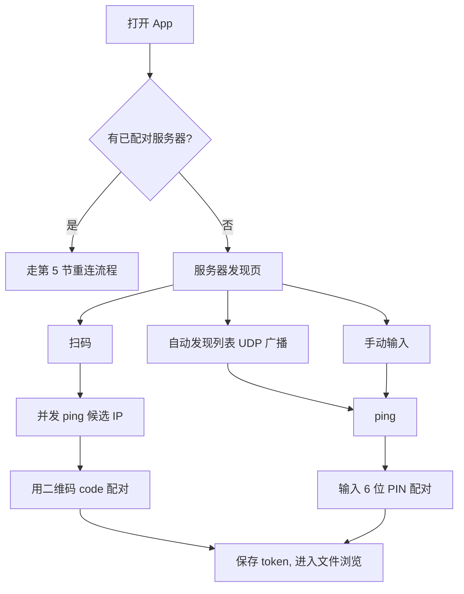
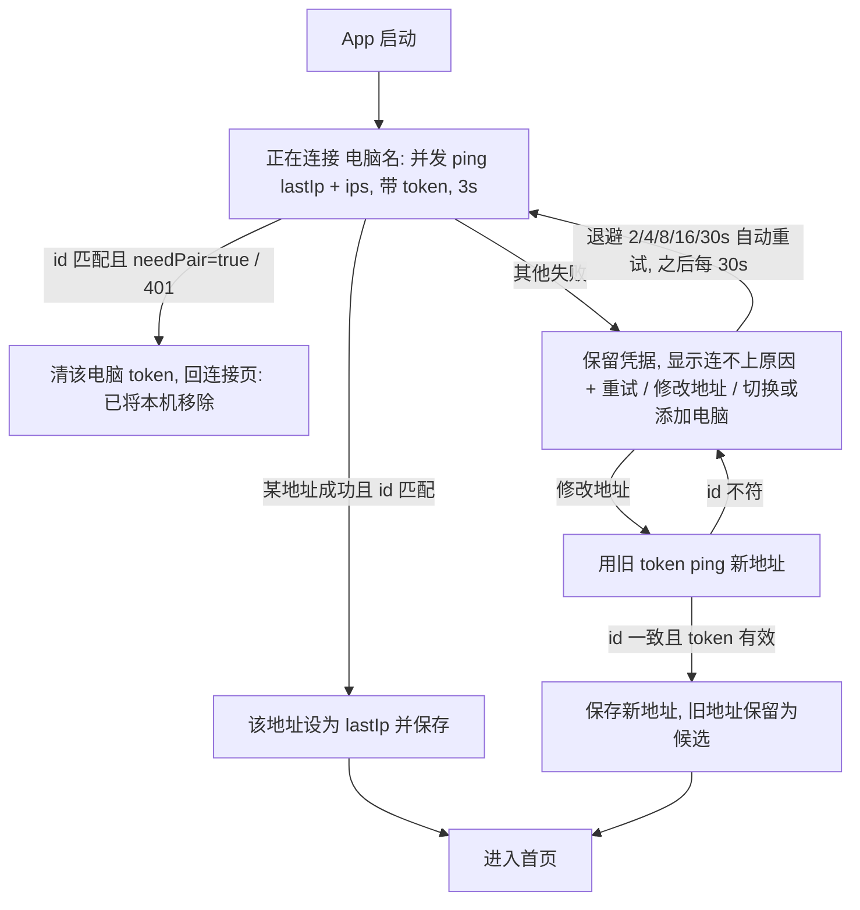

# 01 · 连接设计：手机端发现并连上服务端

> 范围：Flutter App 如何在局域网内找到装在 Windows 上的 Go 服务端，完成配对、鉴权并保持连接。
> 不含：文件浏览、视频播放等业务接口（见后续文档）。

## 1. 总览

| 方式 | 优先级 | 适用场景 | 可靠性 | 需要用户操作 |
| ---- | ---- | ---- | ---- | ---- |
| 扫码连接 | 1（首选） | 首次连接、多网卡电脑 | 高 | 扫一次码 |
| 自动发现（UDP 广播） | 2 | 同网段、路由器不拦广播 | 中 | 选服务器 + 输入 6 位 PIN |
| 手动输入 IP:端口 | 3（兜底） | 组播被屏蔽、特殊网络 | 取决于用户 | 输入 IP + PIN |

端口约定：

| 端口 | 协议 | 用途 |
| ---- | ---- | ---- |
| 8686（可配置） | TCP / HTTP | 业务接口、本机管理网页 |
| 8687 | UDP | 广播发现 |

## 2. 连接方式

### 2.1 扫码连接（首选）

服务端启动后：

- 控制台打印二维码（ASCII）；
- 本机网页 `http://localhost:8686/` 显示同一二维码（并显示 PIN、已配对设备列表）。

二维码内容（URL 形式，字段同样可用 JSON 表达）：

```
lfb://connect?id=<serverId>&name=<电脑名>&port=8686&ips=192.168.1.5,10.0.0.3&code=<一次性配对码>
```

| 字段 | 说明 |
| ---- | ---- |
| `id` | serverId，服务端首次启动生成的 UUID |
| `name` | 电脑名，用于 App 列表展示 |
| `port` | HTTP 端口 |
| `ips` | 本机**全部**候选 IPv4（电脑常有 VPN、Hyper-V、WSL 等虚拟网卡，无法可靠判断哪个是真实局域网地址） |
| `code` | 一次性配对码，扫码即完成配对，无需再输 PIN |

App 侧选 IP 策略：对 `ips` 中每个地址**并发**请求 `GET /api/ping`（短超时，如 1.5s），取第一个成功且 `id` 匹配的地址。



### 2.2 自动发现

> 只做 Android，因此不用 mDNS（省去 zeroconf/bonsoir 依赖，也避开与 Windows 自带 mDNS 服务抢 5353 端口），只用 UDP 广播。

```
App ──(UDP 广播 255.255.255.255:8687, "LFB_DISCOVER")──▶ 服务端
App ◀──(UDP 单播回复 JSON {id,name,version,port,ips})── 服务端
```

- App 连发 3 次（间隔 500ms），收集 2 秒内的回复，按 `id` 去重后列出。
- 服务端回复是单播，App 无需 `MulticastLock`；部分机型若收不到，再申请 `CHANGE_WIFI_MULTICAST_STATE` + `MulticastLock` 兜底。
- Flutter 端用 `dart:io` 的 `RawDatagramSocket`（`broadcastEnabled = true`）即可，无需第三方包。

服务端实现（`server/internal/discovery`）：

| 项 | 规则 |
| ---- | ---- |
| 监听 | UDP `0.0.0.0:8687`（仅 IPv4）；端口被占用时只记日志，HTTP 服务照常启动 |
| 请求 | 数据报内容**恰为** 12 字节 ASCII `LFB_DISCOVER`（无换行、无结尾 0、区分大小写）；其他内容或长度一律不回复 |
| 回复 | 单播到请求的来源地址与端口，UTF-8 JSON，只含 `id`（serverId）、`name`、`version`、`port`（HTTP 端口）、`ips`（同二维码，`LocalIPv4s`，最多 16 个）；不含 PIN、配对码、token、`needPair` |
| 限速 | 按 1 秒窗口：同一来源 IP 最多回复 5 次、全部来源合计最多 50 次，超出的请求直接丢弃（防被伪造源地址用于放大） |
| 开关 | `config.json` 的 `discovery.enabled`（默认 `true`），修改后重启服务端生效；管理页无开关 |

回复示例：

```json
{"id":"d0e590cf-27d1-4e05-810a-320acf2a6ca7","name":"MY-PC","version":"1.2.0","port":8686,"ips":["192.168.1.5","10.0.0.3"]}
```

App 收到回复后按 2.1 的方式并发 `GET /api/ping` 选 IP（回复的来源地址可优先尝试），`needPair` 以 ping 结果为准。

发现到服务器后，若 `needPair=true`，App 提示用户输入服务端控制台/本机网页显示的 **6 位 PIN**。

### 2.3 手动输入 IP:端口

兜底方案。用户输入 `192.168.1.5:8686`（端口缺省 8686）→ App 调 `/api/ping` 校验 → 输入 6 位 PIN 配对。

### 2.4 方式选择流程



## 3. 配对与鉴权

### 3.1 配对码规则

| 类型 | 来源 | 展示位置 | 有效期 | 错误限制 |
| ---- | ---- | ---- | ---- | ---- |
| 一次性配对码 | 嵌在二维码 `code` 中 | 二维码 | 5 分钟，用后作废 | 128 位随机，不受锁定影响，正确即可配对 |
| 6 位 PIN | 服务端随机生成 | 控制台 + 本机网页 | 5 分钟，过期自动刷新 | 按来源 IP 计数：同一 IP 连续错 5 次锁定该 IP 5 分钟；全体 5 分钟内累计错 30 次则刷新 PIN（旧 PIN 作废） |

锁定只针对出错的来源 IP：锁定期间该 IP 的 PIN 配对返回 423，到期自动解除，配对成功清零该 IP 计数；服务端刷新配对码（重启或本机网页）立即解除全部锁定。

### 3.2 配对接口

```
POST /api/pair
{ "code": "123456", "deviceName": "Pixel 8", "deviceId": "<App 生成的 UUID>" }

200 → { "token": "<随机 32 字节, base64url>", "serverId": "...", "name": "..." }
401 → 配对码错误/过期      423 → 已锁定
```

服务端保存 `data/devices.json`（只存 token 哈希，不存明文）：

```json
[
  { "deviceId": "…", "deviceName": "Pixel 8", "tokenHash": "sha256:…", "lastSeen": "2026-11-20T10:00:00+08:00" }
]
```

同一 `deviceId` 重新配对时覆盖旧记录（旧 token 失效）。本机网页可查看并吊销设备。

### 3.3 请求鉴权

| 场景 | 携带方式 |
| ---- | ---- |
| 普通 API 请求 | `Authorization: Bearer <token>` |
| 视频/图片 URL（部分播放器不便加 header） | 查询参数 `?t=<token>`，仅限 `GET /api/file`、`GET /api/download`、`GET /api/thumb`、`GET /api/app/apk/{abi}`；其他接口只认 `Authorization` 头 |

- 服务端对 token 做哈希后查表；无效返回 401（`UNAUTHORIZED`），`/api/ping` 带 token 时 `needPair=true`。App **只在这两种明确的“token 无效”**（且 ping 的 `id` 与保存的 `serverId` 一致）时清除该服务器 token，回连接页提示“这台电脑（<电脑名>）已将本机移除，请重新配对”；超时、不可达、VPN、电脑关机、5xx、id 不符等其他失败一律保留凭据（见第 6 节）。
- App 用 `flutter_secure_storage` 保存 token（Android Keystore）。
- 注意：`?t=` 会出现在 URL 中，服务端日志需脱敏该参数。

## 4. 传输层

| 项 | 决策 |
| ---- | ---- |
| 协议 | HTTP 明文，默认端口 8686（配置文件可改） |
| 不上 HTTPS 原因 | 自签证书需在手机端安装/信任，操作复杂；视频播放器对自签证书支持参差 |
| Android | `network_security_config` 允许明文流量（`cleartextTrafficPermitted="true"`） |

**风险**：同一局域网内的他人可嗅探流量、截获 token 和文件内容（公共 Wi-Fi 下尤其危险）。
**后续可选方案**：
1. 服务端自签证书 + 二维码中带证书指纹，App 做证书固定（pinning），免用户手动信任；
2. 应用层加密（配对时协商密钥）——复杂度高，暂不考虑。

## 5. 接口清单（连接相关）

| 方法 | 路径 | 鉴权 | 说明 |
| ---- | ---- | ---- | ---- |
| GET | `/api/ping` | 免鉴权 | 返回 `{id, name, version, minAppVersion, needPair}`（`minAppVersion` 见 02 §5.3）；带 token 时 `needPair` 反映该 token 是否有效 |
| POST | `/api/pair` | 免鉴权（凭配对码） | 配对，返回长期 token |
| GET | `/api/devices` | 仅 127.0.0.1 | 已配对设备列表（本机网页使用） |
| DELETE | `/api/devices/{id}` | 仅 127.0.0.1 | 吊销设备 |

本机限制以 TCP 连接的远端地址判断（`RemoteAddr`），不信任 `X-Forwarded-For` 等头。

## 6. 断线重连与 IP 变化

App 本地保存已配对服务器列表：

| 字段 | 说明 |
| ---- | ---- |
| `serverId` | 识别“同一台电脑”的唯一依据（服务端首次启动生成的 UUID，持久化在配置中） |
| `name` | 显示名 |
| `lastIp` / `port` | 上次成功连接的地址 |
| `ips` | 其他已知地址：扫码时二维码里的全部 `ips`、以前成功过的地址；同一 serverId 再次保存时合并 |
| `token` | 存于 secure storage（读取异常按无 token 处理，不抛出） |

连接信息一经保存就一直有效，除非电脑端删除该设备（第 3.3 节）。"切换或添加电脑"只改“上次使用”，不删除已保存的电脑；连接页列出全部已保存的电脑，点即用已保存凭据连接。



- ping 返回的 `id` 与保存的 `serverId` 不符时，视为该地址被其他电脑占用：跳过该地址，不算授权失效。
- 电脑换了 IP 且新 IP 不在已知地址中：在“正在连接”页点“修改地址”输入新 IP:端口，无需重新配对。
- 运行中断线：播放器按退避重试（05 §4.3），每次重试、首页下拉刷新都会并发轮询全部已知地址，换到可用地址后保存为 `lastIp`。
- UDP 广播按 serverId 查找新 IP 尚未实现（自动发现完成后接入上述流程）。

## 7. Windows 防火墙与网络排错

**防火墙**：首次运行时 Windows 会弹窗，需勾选“**专用网络**”。若当前网络被识别为“**公用网络**”，入站连接会被拦截。手动添加规则（管理员权限）：

```bat
netsh advfirewall firewall add rule name="LAN File Browser" dir=in action=allow protocol=TCP localport=8686
netsh advfirewall firewall add rule name="LAN File Browser UDP" dir=in action=allow protocol=UDP localport=8687
```

由安装包在安装时自动添加（见 02-release.md）。

**排错表**

| 现象 | 可能原因 | 处理 |
| ---- | ---- | ---- |
| 扫码后所有 IP 都 ping 不通 | 防火墙拦截 / 网络为“公用网络” | 加防火墙规则，或将网络改为“专用” |
| 同 Wi-Fi 仍连不上 | 路由器开启“AP 隔离” / 连的是“访客网络” | 关闭 AP 隔离，手机与电脑接入同一主网络 |
| 自动发现列表为空，扫码可用 | 路由器屏蔽广播 / UDP 8687 被拦 | 使用扫码或手动输入 |
| 手机与电脑不在同一网段 | 手机用流量 / 电脑接有线另一子网 | 确认两端在同一网段 |
| 配对提示已锁定 | 同一台设备（IP）连续输错 PIN 5 次 | 5 分钟后重试，或改用扫码配对（不受锁定影响） |
| 能 ping 但请求 401 | token 被吊销 / 服务端数据被清 | 重新配对 |
| 二维码中 IP 都是虚拟网卡地址 | 网卡识别问题 | 手动输入真实局域网 IP |
| 手机开着 VPN（如 Clash）时连不上 | 局域网请求被 VPN 接管 | 见 7.1 |

### 7.1 手机开着 VPN

| 项 | 设计 |
| ---- | ---- |
| 绕过 VPN | App 启动时（`MainActivity`）用 `registerNetworkCallback` 跟踪底层 Wi-Fi（`TRANSPORT_WIFI`，默认请求带 `NOT_VPN`，不匹配 VPN 网络）：可用时 `bindProcessToNetwork(wifi)`，整个进程（Dart `HttpClient`、libmpv 原生 socket）的连接都走 Wi-Fi；该 Wi-Fi 丢失时 `bindProcessToNetwork(null)` 解绑。需 `ACCESS_NETWORK_STATE` |
| 局限 | 仅当 VPN 允许绕过（`VpnService.Builder.allowBypass()`）时有效；不允许时绑定失败或连接仍被 VPN 接管，异常一律忽略、不影响 App。绑定后 App 访问外网（如检查更新）也走 Wi-Fi 而非 VPN |
| 检测与提示 | MethodChannel `isVpnActive()`：任一网络带 `TRANSPORT_VPN` 即为真。以下网络类错误（`NetworkException`，服务端已响应的错误除外）在为真时另起一行追加：“手机开着 VPN，可能拦截了局域网连接。请在 VPN 里打开‘绕过局域网/私有网络’，或在分应用代理中排除 LAN File Browser。” |
| 提示位置 | 连接页扫码 / 手动配对失败、超时、“二维码里的地址都连不上”；启动时“正在连接”页连不上已保存的电脑；播放断线重连全部失败 |

## 8. 已确认决策

| # | 问题 | 结论 |
| ---- | ---- | ---- |
| 1 | 平台 | 只做 Android，自动发现仅用 UDP 广播 |
| 2 | 多用户 / 只读权限 | 按共享文件夹设置权限及可见手机，见 03-file-api.md |
| 3 | 外网访问 | 本期不做 |
