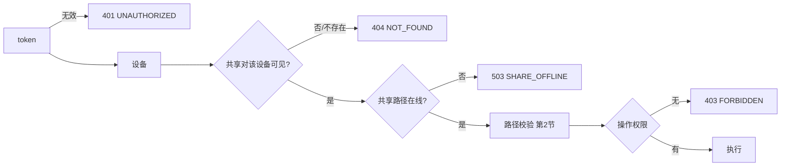

# 03 · 文件浏览接口与路径安全

> 范围：服务端对 App 提供的文件浏览、播放、下载、缩略图、下一集、字幕、观看进度、上传/重命名/删除接口，以及路径安全与权限校验。
> 前置：鉴权（`Authorization: Bearer <token>`；`?t=<token>` 仅限 `/api/file`、`/api/download`，P2 实现 `/api/thumb` 时加入）、端口 8686 见 [01-connection.md](01-connection.md)；共享文件夹与权限由本机管理页配置，见 [desgin/brief.md](desgin/brief.md)。
> 说明：本文接口取代 README 中的「初步 API」（`/api/roots`、`?path=` 等），以本文为准。

## 1. 虚拟路径模型

App 永远不接触电脑真实路径（如 `D:\Movies`），真实路径只存在于服务端配置。

| 概念 | 说明 | 示例 |
| ---- | ---- | ---- |
| `shareId` | 共享创建时生成的短 ID（8 位 base32 随机），**不随显示名改名而变**；进度、缩略图缓存都以它为键 | `k3f9q2ma` |
| 显示名 | 手机上看到的名字，可随时改 | `动漫` |
| `path` | 共享内相对路径，`/` 分隔，不以 `/` 开头；空串表示共享根 | `进击的巨人/S01/E12.mkv` |
| 真实路径 | 仅服务端：共享根（启动时 `filepath.EvalSymlinks` 规范化）+ `path` | `D:\Anime\进击的巨人\S01\E12.mkv` |

所有文件类接口统一参数：`share=<shareId>&path=<相对路径>`（URL 编码）。返回给 App 的条目也只含 `name` 与相对 `path`。

## 2. 路径安全

### 2.1 三层防护

| 层 | 手段 | 作用 |
| ---- | ---- | ---- |
| 1 词法校验 | 反斜杠统一转 `/` 后按段检查（见 2.2） | 早拒绝，返回明确的 `BAD_PATH` |
| 2 `os.Root` | 每次请求 `os.OpenRoot(共享根)`，所有访问走 `root.Open/Stat/Lstat/ReadDir/Rename/Remove…` | **机制上**阻止 `..` 与符号链接逃逸 |
| 3 最终路径校验 | 打开后用 `GetFinalPathNameByHandle` 取真实长路径，要求以共享根为前缀（大小写不敏感，按分隔符边界比较），并对**最终路径**各段再做隐藏/系统项过滤 | 纵深防御；顺带消解 8.3 短名、联接等绕过 |

`os.OpenRoot` 每请求打开、用完即关（`root.Open` 返回的文件不依赖 root 存活）：避免长期占用目录句柄导致移动硬盘/U 盘无法弹出。

### 2.2 攻击样例 → 处理

| 攻击样例 | 风险 | 处理 |
| ---- | ---- | ---- |
| `../Windows/win.ini`、`a/../../b` | 目录穿越 | 任何段为 `..` 或 `.` → `BAD_PATH`（比 `os.Root` 更严，`os.Root` 允许不逃逸的 `..`） |
| `/etc/x`、空段 `a//b` | 绝对路径 / 歧义 | 以 `/` 开头或含空段 → `BAD_PATH` |
| `C:/Windows`、`C:x` | 盘符 | 任意位置含 `:` → `BAD_PATH` |
| `\\server\share\x`、`\\?\C:\`、`\\.\COM1` | UNC / 设备命名空间 | `\` 转 `/` 后以 `/` 开头 → `BAD_PATH` |
| `..\..\x` | 反斜杠绕过 | 先把 `\` 统一转为 `/` 再分段，按 `..` 规则拒绝 |
| `a.txt:secret`、`a.txt::$DATA` | NTFS 备用数据流 | 含 `:` → `BAD_PATH` |
| `CON`、`nul.txt`、`COM1`、`LPT¹`、`CONIN$` | 设备名（带扩展名也生效） | 段主名（第一个 `.` 前，去尾空格）大小写不敏感匹配 `CON PRN AUX NUL COM0-9 LPT0-9 COM¹²³ LPT¹²³ CONIN$ CONOUT$` → `BAD_PATH`；`os.Root` 在 Windows 上同样拒绝 |
| `secret.txt.`、`secret.txt ` | Windows 静默去掉结尾点/空格，绕过名单匹配 | 段以 `.` 或空格结尾 → `BAD_PATH` |
| `a%00.mp4` | 空字节截断 | 含 `\x00`–`\x1F` 或 `< > " \| ? *` → `BAD_PATH` |
| `PROGRA~1`、`$RECYC~1` | 8.3 短名绕过隐藏名单 | 段匹配短名形态（`~` + 数字）时，以第 3 层最终路径的长名为准做过滤；长名与请求段不一致 → `NOT_FOUND`（与不存在一致，避免探测存在性） |
| `$recycle.bin`、`DESKTOP.INI` | 大小写绕过 | 所有名单比较一律大小写不敏感（`strings.EqualFold`） |
| 非法 UTF-8、超长路径 | 解析异常 | 非法 UTF-8 或 `path` > 4096 字节、单段 > 255 字符 → `BAD_PATH` |
| 共享内放一个指向 `C:\` 的联接 | 链接逃逸 | 见 2.3，目标不在本共享内 → `NOT_FOUND` |

### 2.3 符号链接与目录联接（junction）

规则：**仅当目标仍在同一共享内才跟随，否则视为不存在**（列表中不出现，直接访问返回 `NOT_FOUND`）。

> **官方核实（pkg.go.dev/os#Root、go.dev/blog/osroot）**：`Root` 的方法会跟随符号链接，但链接不得指向 root 之外，且**符号链接不得为绝对路径**；`root.Open("a/../b")` 在 Windows 上按词法解析为 `b`（即使 `a` 不存在）；Windows 上文件名不得引用 `NUL`、`COM1` 等保留设备名；`Root` 不阻止跨文件系统边界。
> **与原设想的差异**：Windows 的目录联接**必然是绝对目标**，`mklink` 创建的符号链接也常为绝对目标，因此仅靠 `os.Root` 会把「指向共享内的绝对链接」也拒掉；文档对 junction 未单独说明。故需补一步手动解析：

| 链接类型 | `os.Root` 行为 | 本服务处理 |
| ---- | ---- | ---- |
| 相对符号链接，目标在共享内 | 跟随 | 直接使用 |
| 相对符号链接，目标逃出共享 | 报错 | `NOT_FOUND` |
| 绝对符号链接 / 目录联接 | 拒绝（junction 行为以实测为准） | `root.Lstat` 识别为链接 → `root.Readlink`（Go 1.25+）→ `EvalSymlinks` 得真实目标 → 若在共享根之下，换算成共享内相对路径再 `root.Open`（最多 8 跳，防环）；否则 `NOT_FOUND` |
| 共享根本身是链接 | `OpenRoot` 跟随根路径中的链接 | 启动时规范化共享根真实路径，供第 3 层前缀比较 |

P1 验收需包含上述四种链接在 Windows 上的实测用例。

### 2.4 隐藏与系统项

| 类别 | 判定 | 显示隐藏文件=关 | 显示隐藏文件=开 |
| ---- | ---- | ---- | ---- |
| 始终隐藏 | `$RECYCLE.BIN`、`System Volume Information`、`desktop.ini`、`thumbs.db`、上传临时文件 `.lfb-upload-*` | 不列出，访问 `NOT_FOUND` | 同左 |
| 隐藏文件 | Windows `Hidden` 属性，或名称以 `.` 开头 | 不列出，访问 `NOT_FOUND` | 列出，`hidden: true` |

判定作用于路径的**每一段**（隐藏目录下的文件同样不可见）。

## 3. 权限校验（每个请求）



| 权限（管理页开关） | 字段 | 控制的接口 |
| ---- | ---- | ---- |
| 浏览与播放（始终开） | — | shares / list / file / thumb / next / subtitles / progress / continue |
| 下载到手机 | `download` | `/api/download`（及 App 的下载按钮） |
| 从手机上传 | `upload` | `/api/upload` |
| 删除与重命名 | `modify` | `/api/rename`、`/api/delete` |
| 显示隐藏文件 | `showHidden` | 影响 2.4 过滤（无权时隐藏项按 404 处理，不是 403） |

- 不可见共享一律 `404`，不用 `403`，避免泄露其存在；`403` 仅用于「共享可见但该操作无权限」。
- **诚实说明**：「下载」权限只控制 App 的下载按钮和 `/api/download`。能播放/看图就意味着字节已到达手机，技术上无法杜绝抓包或另存，它是便利性开关而非 DRM。

## 4. 接口清单

通用：全部需鉴权；错误格式见第 7 节；时间为 RFC 3339，`mtime` 为 Unix 毫秒。

### 4.1 GET /api/shares

返回当前设备可见的共享。

| 字段 | 说明 |
| ---- | ---- |
| `id` / `name` | shareId / 显示名 |
| `perms` | `{download, upload, modify, showHidden}` 布尔 |
| `status` | `ok` / `offline`（路径不存在，如硬盘未连接） |

### 4.2 GET /api/list

参数：`share`、`path`、`sort=name|mtime|size`（默认 `name`）、`order=asc|desc`、`offset`（默认 0）、`limit`（默认 200，最大 1000）。

| 返回字段 | 说明 |
| ---- | ---- |
| `items[]` | `name`、`kind`、`size`（目录为 0）、`mtime`、`hidden`、`hasThumb`、`progress` |
| `kind` | `dir` / `video` / `image` / `audio` / `subtitle` / `other`（按扩展名） |
| `progress` | 仅视频；本设备进度 `{position, duration, watched}`，无则 `null`（秒） |
| `total` | 过滤后条目总数，用于分页 |

- 目录始终排在文件前；`name` 排序用**自然排序**（数字段按数值比较，大小写不敏感）：`第2集` 在 `第10集` 前。
- 响应头 `ETag` = 过滤后完整列表（名称+大小+mtime+权限位）的哈希；App 带 `If-None-Match` 刷新，未变返回 `304`。不用目录 mtime（NTFS 上文件内容变化不更新目录 mtime）。
- 错误：`BAD_PATH`、`NOT_FOUND`（含「不是目录」）、`SHARE_OFFLINE`。

### 4.3 GET /api/file

参数：`share`、`path`；允许 `?t=<token>`（供播放器/图片组件直接使用 URL）。

- `http.ServeContent` 输出，自动支持 `Range`/`206`/`If-Range`/`If-Modified-Since`；`416` 由其自行返回（非统一 JSON 格式）。
- MIME 用内置扩展名表，**不用 `mime.TypeByExtension`**（Windows 上读注册表，结果因机器而异）：

| 扩展名 | MIME | 扩展名 | MIME |
| ---- | ---- | ---- | ---- |
| mp4 m4v | video/mp4 | jpg jpeg | image/jpeg |
| mkv | video/x-matroska | png / webp / gif | image/png / image/webp / image/gif |
| webm | video/webm | mp3 / flac / m4a | audio/mpeg / audio/flac / audio/mp4 |
| avi | video/x-msvideo | srt / vtt | application/x-subrip / text/vtt |
| ts m2ts | video/mp2t | ass ssa | text/x-ssa |
| 其他 | application/octet-stream | | |

- 错误：`BAD_PATH`、`NOT_FOUND`（含目录）、`SHARE_OFFLINE`。

### 4.4 GET /api/download

同 4.3，另加 `Content-Disposition: attachment; filename*=UTF-8''<编码后文件名>`（中文名用 RFC 5987）。需 `download` 权限，否则 `403 FORBIDDEN`。

### 4.5 GET /api/thumb

参数：`share`、`path`、`w`（取整到 160/320/640）；允许 `?t=`。返回 JPEG，`Cache-Control: private, max-age=86400`。（实现时需把 `/api/thumb` 加入服务端 `?t=` 白名单。）

| 来源 | 生成方式 | `hasThumb` |
| ---- | ---- | ---- |
| 图片 jpg/png/gif/webp | Go 图像库（`image/*` + `golang.org/x/image/webp`）解码缩放 | true |
| 视频 | ffmpeg 截取约 10% 处一帧（PATH 或配置中找到 ffmpeg 时） | 有 ffmpeg 才 true |
| 其他（含 HEIC） | — | false，App 用占位封面 |

- 缓存：`%LOCALAPPDATA%\LanFileBrowser\cache\thumbs\<sha256(shareId+path+mtime+size+w)>.jpg`；文件变更后键自然失效，缓存总量超上限（默认 1 GB）按访问时间淘汰。
- 生成并发上限 2（避免 ffmpeg 抢占 CPU）；`hasThumb` 表示「可生成」，不表示已缓存。
- 错误：`NOT_FOUND`（含不支持的类型）、`SHARE_OFFLINE`。

### 4.6 GET /api/next

参数：`share`、`path`（当前视频）。返回 `{item}`（同 list 条目，另含 `path`）或 `{item: null}`。

1. 取同目录视频文件，自然排序。
2. 解析集号（按优先级取第一个命中）：

| 模式 | 示例 |
| ---- | ---- |
| `S(\d+)E(\d+)` | `Show.S01E12.1080p.mkv` |
| `EP?(\d+)` | `E12`、`EP12` |
| `第(\d+)[集话話]` | `第12集` |
| `\[(\d+)\]` | `[Sub][12][1080P].mkv` |
| ` - (\d+) ` | `Show - 12 [x265].mkv` |

   排除 `1080p`/`720p`、`x264/x265`、19xx/20xx 年份等干扰数字。
3. 当前文件解析出集号 → 取集号大于它的最小者（能解析出剧名时只在规范化后同名的剧集中找，避免同目录混放多部剧时串剧）；未解析出，或同目录其他视频都解析不出集号 → 取自然排序的下一个。
4. 同目录无下一集（P3）：在父目录中找相邻季文件夹（`第二季`/`Season 2`/`S02`，季号 +1），取其第一集。

### 4.7 GET /api/subtitles

参数：`share`、`path`（视频）。返回 `items[]`：`{name, path, format, lang, match}`，App 通过 `/api/file` 拉取；按 `exact`、`episode`、`season` 顺序排列。

| `match` | 规则 | 示例（视频 `E12.mkv`） |
| ---- | ---- | ---- |
| `exact` | 同名，扩展名 `.srt .ass .ssa .vtt` | `E12.ass` |
| `exact` | 同名 + 语言后缀，`lang` 取后缀 | `E12.chs.srt`、`E12.zh-CN.ass` |
| `episode` | 同目录字幕中集号与视频相同（字幕组文件名与视频不一致时） | `[字幕组] Show [12].chs.ass` |
| `season` | 字幕只标季不标集，剧名（规范化后）与季号和视频相同（视频未标季视为第 1 季） | 视频 `Show.S01E12.mkv` 时的 `Show.S01.chs.srt` |

### 4.8 观看进度：POST /api/progress、GET /api/continue

服务端按设备存储，同时提供**家庭共享进度**：手机看到第 12 集，电视「继续观看」能接着看。

| 接口 | 说明 |
| ---- | ---- |
| `POST /api/progress` | Body `{share, path, position, duration}`（秒）。App 播放中每 10 秒、暂停、退出时上报。返回 `204` |
| `GET /api/continue` | 继续观看列表（最多 20 条）：按「共享+目录」聚合，取所有设备中最近一条；字段 `share, path, name, position, duration, updatedAt, deviceName`；若已看完则附 `next`（4.6 结果），无下一集则不出现 |

- 看完判定：`position ≥ 90% × duration` 或 `duration − position < 120 秒`。
- 仅返回本设备当前可见共享内的记录（不泄露不可见共享）。
- 存储：SQLite（`modernc.org/sqlite`，纯 Go，无需 cgo），`%APPDATA%\LanFileBrowser\data.db`。表 `progress(device_id, share_id, path_key, path, position, duration, watched, updated_at)`，主键 `(device_id, share_id, path_key)`；`path_key` 为 Go 侧 `strings.ToLower` 结果（SQLite `NOCASE` 只处理 ASCII）。文件改名/删除后的孤儿记录不主动清理，读取时跳过。
- 01 文档中的 `devices.json` 也可迁入同库，由实现阶段决定。

### 4.9 POST /api/upload

`multipart/form-data`，字段 `share`、`path`（目标目录）、`file`（可多个）。需 `upload` 权限。

1. 流式写入目标目录下临时文件 `.lfb-upload-<随机>`（`root.OpenFile` + `O_CREATE|O_EXCL`），超出单文件上限（配置 `maxUploadMB`）立即中止并删除临时文件 → `413 TOO_LARGE`。
2. 完成后选定最终名：重名时自动加 ` (1)`、` (2)`…（`电影.mp4` → `电影 (1).mp4`）；进程内按目录加锁，防止并发上传选中同名。
3. `root.Rename` 原子重命名（Go 1.25+）。中断/失败删除临时文件；服务启动时清理残留 `.lfb-upload-*`。

返回 `items[]`（最终条目）。文件名按 2.2 规则校验，非法 → `BAD_PATH`。

### 4.10 POST /api/rename、POST /api/delete

需 `modify` 权限。不允许作用于共享根。

| 接口 | Body | 说明 | 错误 |
| ---- | ---- | ---- | ---- |
| rename | `{share, path, newName}` | 仅同目录改名；`newName` 为单段，按 2.2 校验；目标已存在 → `CONFLICT`（仅大小写变化允许） | `BAD_PATH` `NOT_FOUND` `CONFLICT` `FORBIDDEN` |
| delete | `{share, paths: []}` | 默认**移入 Windows 回收站**（`IFileOperation`，`FOFX_RECYCLEONDELETE`），不永久删除；所在盘无回收站（如部分 U 盘）时返回失败而非静默永久删除 | `NOT_FOUND` `FORBIDDEN` |

回收站 API 只接受绝对路径：先经 `os.Root` 打开并通过第 3 层校验取得最终路径，关闭句柄后再交给 Shell（存在极短 TOCTOU 窗口，局域网家庭场景可接受）。

## 5. 实时性

| 阶段 | 方案 |
| ---- | ---- |
| P1 | App 进入目录、下拉刷新、回到前台时请求 `/api/list`，带 `If-None-Match`，未变 `304` |
| P3 | `GET /api/events?share&path`（SSE）：服务端用 `fsnotify` **只监听当前有客户端在看的目录**（引用计数，最后一个客户端断开即取消），变更去抖 500 ms 后推送 `event: changed`，App 收到后自动带 ETag 刷新；15 秒心跳注释行保活 |

## 6. 不做服务端转码

| 项 | 说明 |
| ---- | ---- |
| 做法 | 视频原样输出（4.3），App 用 `media_kit`（libmpv）播放，支持 mkv、HEVC、AC3/DTS、ASS 特效字幕等 |
| 理由 | 服务端保持轻量（单 exe、家用电脑不被转码占满 CPU）；不强依赖 ffmpeg（仅缩略图可选使用）；原画质、可任意拖动 |
| 代价 | 极老手机无 HEVC 硬解时只能软解，4K/高码率可能卡顿；Wi-Fi 带宽需撑住原始码率 |

## 7. 统一错误格式

```json
{"error":{"code":"NOT_FOUND","message":"文件不存在"}}
```

| code | HTTP | 场景 |
| ---- | ---- | ---- |
| `UNAUTHORIZED` | 401 | token 缺失/无效/已吊销 |
| `NOT_FOUND` | 404 | 共享不存在或对该设备不可见、文件不存在、链接逃逸、隐藏/系统项 |
| `FORBIDDEN` | 403 | 仅用于可见共享内的操作无权限 |
| `BAD_PATH` | 400 | 违反 2.2 规则、参数非法 |
| `CONFLICT` | 409 | 重命名目标已存在 |
| `TOO_LARGE` | 413 | 上传超过单文件上限 |
| `SHARE_OFFLINE` | 503 | 共享路径不存在（如硬盘未连接） |

`message` 仅供展示，不含真实路径；服务端日志记录真实路径但对 `?t=` 脱敏。

## 8. 关键片段（示意）

```go
// 打开共享内文件：词法校验 → os.Root → 最终路径校验
func (s *Share) Open(rel string) (*os.File, error) {
	if err := validateRel(rel); err != nil { // 第 1 层，见 2.2
		return nil, ErrBadPath
	}
	root, err := os.OpenRoot(s.RealPath) // 每请求打开，避免占住移动硬盘
	if err != nil {
		return nil, ErrShareOffline
	}
	defer root.Close() // 已打开的文件不受影响
	f, err := root.Open(cmp.Or(rel, "."))  // 第 2 层，机制上防逃逸
	if err != nil {
		f, err = s.openViaAbsLink(root, rel) // 2.3：绝对链接/联接手动解析
		if err != nil {
			return nil, ErrNotFound
		}
	}
	final, err := finalPathByHandle(f) // GetFinalPathNameByHandleW
	if err != nil || !s.within(final) || s.hiddenOrSystem(final) { // 第 3 层
		f.Close()
		return nil, ErrNotFound
	}
	return f, nil
}
```

依赖最低 **Go 1.25**（`Root.Rename`、`Root.Readlink` 在 1.25 加入；`OpenRoot/Open/Stat/Lstat/OpenFile/Remove` 为 1.24）。

## 9. 分期

| 阶段 | 内容 |
| ---- | ---- |
| P1 | `/api/shares`、`/api/list`（含 ETag）、`/api/file`、`/api/download`、路径安全三层 + 链接实测用例、权限校验、统一错误 |
| P2 | `/api/next`（同目录）、`/api/subtitles`、`/api/progress`、`/api/continue`、`/api/thumb` |
| P3 | `/api/upload`、`/api/rename`、`/api/delete`（回收站）、`/api/events`（SSE）、跨季下一集 |

## 10. 待确认问题

| # | 问题 | 建议 |
| ---- | ---- | ---- |
| 1 | `list` 中的 `progress` 是只显示本设备进度，还是显示全家最近进度（电视上能看到手机看到哪了）？ | 按当前决策显示本设备；家庭共享通过 `/api/continue` 体现。若希望列表也共享，改为「全家最近一条 + `deviceName`」即可，存储结构不变 |
