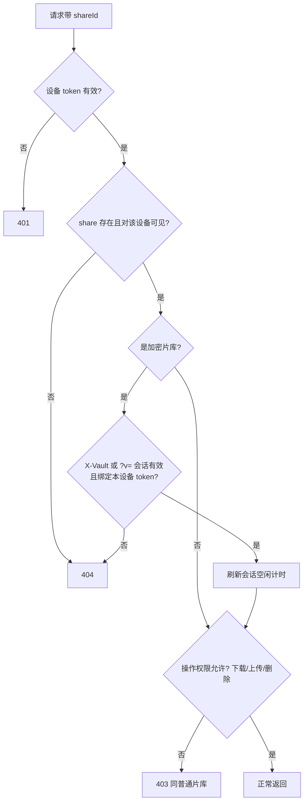

# 04 · 加密片库（私密片库）设计

> 范围：给共享文件夹加“密码锁”，锁定时在手机/电视 App 中完全隐藏。
> 依赖：鉴权、token、`?t=` 见 [01-connection.md](01-connection.md)；共享文件夹与权限模型见 [desgin/brief.md](desgin/brief.md)；`shareId` 及 `/api/shares`、`/api/list`、`/api/continue`、`/api/thumb`、`/api/next` 等接口见 03-file-api.md。
> 不含：实现代码。

## 1. 定位：密码锁，不是文件加密

文件在电脑上照常存放、不做任何加密；加密片库只决定 **App 能不能看到这个共享文件夹**，防的是家里其他人在手机/电视 App 里看到。

| 能防 | 不能防 |
| ---- | ---- |
| 家人拿起已配对的手机/电视，在 App 里浏览、搜索、看“继续观看” | 能直接操作这台电脑的人（资源管理器、管理页都能看到） |
| 从 App 界面推测“是否存在私密片库”（入口、文案、接口响应均不暴露） | 局域网抓包：传输是 HTTP 明文（见 01 文档第 4 节），密码、会话、文件内容均可被嗅探 |
| 最近任务缩略图、截屏、本地缓存残留 | 已下载到手机上的文件（离开 App 管控） |
| 电视首页轮播、日志等“旁路”泄露 | 知道密码的人 |

## 2. 术语

| 术语 | 含义 |
| ---- | ---- |
| 共享文件夹 / share | brief.md 中的共享文件夹，接口中以 `shareId` 标识（见 03-file-api.md） |
| 加密片库 / vault | 开启了“设为加密片库”的共享文件夹 |
| 设备 token | 配对得到的长期 token（见 01 文档 3.2） |
| 解锁会话 / session | 输入正确密码后获得的短期随机令牌，与设备 token 绑定 |

## 3. 电脑端管理页（可信端）

| 项 | 设计 |
| ---- | ---- |
| 开关 | 每个共享文件夹可开启“设为加密片库”，开启时必须设置密码 |
| 密码规则 | 4–16 位，允许纯数字 |
| 独立密码 | 每个片库单独设密码；App 输入一个密码，**解锁所有密码匹配的片库** |
| 用法 | 多个片库同一密码 = 一个私密空间；不同密码 = 不同家人各自的私密片库 |
| 存储 | argon2id（`golang.org/x/crypto/argon2`）加盐哈希，存于共享配置 |
| 显示 | 管理页始终显示全部片库，加密片库加标记 |
| 忘记密码 | 只能在管理页重设，无需旧密码（文件未加密，不会丢数据） |
| 关闭 | 关闭开关即删除 `vault` 字段，片库恢复为普通共享 |

配置示例（在 brief.md 的共享配置上增加 `vault`）：

```json
{
  "shareId": "s_7f3a",
  "name": "旅行",
  "path": "E:\\Private\\Trip",
  "visibleTo": ["<deviceId 小米 14>"],
  "perms": { "download": true, "upload": false, "delete": false, "hidden": false },
  "vault": {
    "enabled": true,
    "passwordHash": "<base64>",
    "salt": "<base64, 16 字节随机>",
    "params": { "time": 3, "memoryKiB": 65536, "threads": 2, "keyLen": 32 }
  }
}
```

> `params` 随哈希一起保存，便于以后调整参数而不影响已有密码。

## 4. App 入口（无可见入口）

| 端 | 触发方式 | 密码框 |
| ---- | ---- | ---- |
| 手机（a4） | 首页**长按电脑名称** | 与普通对话框同款，标题“输入密码”，数字/字母键盘可切换 |
| 电视（t4） | 首页**长按遥控器“菜单”键** | 同上，遥控器可输入数字 |

- 界面任何地方都不出现“私密”“加密”“片库已锁定”等字样。
- 密码错误与“没有加密片库”表现完全一致：清空输入并轻微抖动，对话框保留可重输，不出现任何文字提示（不提示“密码错误”）。

## 5. 服务端接口

| 方法 | 路径 | 鉴权 | 说明 |
| ---- | ---- | ---- | ---- |
| POST | `/api/vault/unlock` | 设备 token | 请求 `{password}`，**始终 200** |
| POST | `/api/vault/lock` | 设备 token + `X-Vault` | 立即销毁会话，始终 200 |

`/api/vault/unlock` 响应：

```json
{ "session": "<随机 32 字节 base64url | null>", "expiresIn": 600, "shares": [ /* 同 /api/shares 的条目 */ ] }
```

| 规则 | 设计 |
| ---- | ---- |
| 形态一致 | 密码错误 / 无加密片库 / 被限流：`session: null, shares: []`，状态码、字段、长度量级相同 |
| 时间一致 | 对所有加密片库逐个做 argon2 校验（无片库时做等量的假校验），并补齐到固定最短耗时（如 800ms） |
| 防暴力 | 每设备每分钟最多 5 次；超限后 5 分钟内一律返回空结果，不报错 |
| 会话 | 随机令牌，绑定设备 token，仅存服务端内存（重启即全部失效） |
| 失效 | 空闲 10 分钟、`/api/vault/lock`、设备被吊销 |
| 可见性 | 返回的 `shares` 只含**对该设备可见**且密码匹配的片库 |

请求加密片库内任何资源：

| 场景 | 携带方式 |
| ---- | ---- |
| 普通 API | `Authorization: Bearer <token>` + `X-Vault: <session>` |
| 视频/图片 URL | `?t=<token>&v=<session>`（日志同样脱敏 `v`） |

无有效会话访问加密片库的任何 `shareId` → **404**，响应与“不存在”完全相同。

## 6. 访问判定流程



顺序固定：**先看设备可见，再看是否解锁，最后看操作权限**。加密片库仍受“哪些手机可见”和下载/上传/删除等权限约束。

## 7. 隐藏范围（服务端逐项）

无有效会话时，以下位置一律不出现加密片库的任何内容：

| # | 位置 | 锁定时 | 解锁时 |
| ---- | ---- | ---- | ---- |
| 1 | `/api/shares` 共享列表 | 不返回 | 仍不返回；加密片库只经 unlock 响应下发 |
| 2 | `/api/list` | 404 | 正常 |
| 3 | `/api/continue` 继续观看 | 过滤掉 | 带 `X-Vault` 时合并返回 |
| 4 | 最近添加 | 过滤掉 | 带 `X-Vault` 时合并返回 |
| 5 | `/api/thumb` 缩略图 | 404 | 正常 |
| 6 | `/api/next` 下一集 | 404 | 正常 |
| 7 | 搜索（若后期有） | 不检索 | 只检索已解锁片库 |
| 8 | 播放进度列表 | 过滤掉 | 带 `X-Vault` 时返回 |
| 9 | 电视 t4 首页“相册画报”轮播 | **绝不取** | **仍然不取** |
| 10 | 服务端日志 | 不记录加密片库内文件名/路径（只记 shareId 与状态码） | 同左 |

- 播放进度仍照常记录，只是只在解锁会话中返回。
- 服务端统计/缓存（如缩略图磁盘缓存）若存在，加密片库的缓存与普通片库同等对待，但不得通过任何未鉴权接口暴露。

## 8. App 侧行为

| 项 | 行为 |
| ---- | ---- |
| 首页 | 解锁后加密片库与普通片库样式相同出现；是否加极小的不显眼标识由设计阶段决定 |
| 自动上锁 | App 切后台、锁屏、空闲 10 分钟 → 立即调 `/api/vault/lock`、丢弃 session、返回首页 |
| 播放中 | 切后台同样上锁并**停止播放** |
| 防截屏 | 处于加密片库内（含播放器、图片查看）时窗口设 `FLAG_SECURE`：最近任务缩略图空白、不能截屏 |
| 缩略图 | 只放内存缓存，不写磁盘；上锁时清空 |
| 最近播放 | 不写入本地“最近播放” |
| 会话存储 | 只在内存，不写 secure storage / 磁盘 |
| 会话失效 | 收到 404 时视为已上锁，回到首页，不提示原因 |

## 9. 分期与待同步事项

**分期**：建议放在 **P2**，依赖 03-file-api.md 的 `/api/shares`、`/api/list` 完成后实现。

| 需同步更新 | 内容 |
| ---- | ---- |
| 管理页设计 v5（v5-home-theater.html） | 共享文件夹行加“设为加密片库”开关、设置/修改密码入口、加密片库标记 |
| 手机设计 a4 | 首页长按电脑名称弹出“输入密码”对话框；解锁后片库展示 |
| 电视设计 t4 | 首页长按“菜单”键弹出密码框；“相册画报”排除加密片库 |
| desgin/brief.md | 权限列表补充“设为加密片库（密码）” |
| 03-file-api.md | 各接口说明 `X-Vault` / `?v=` 与 404 规则（由该文档作者补充） |
