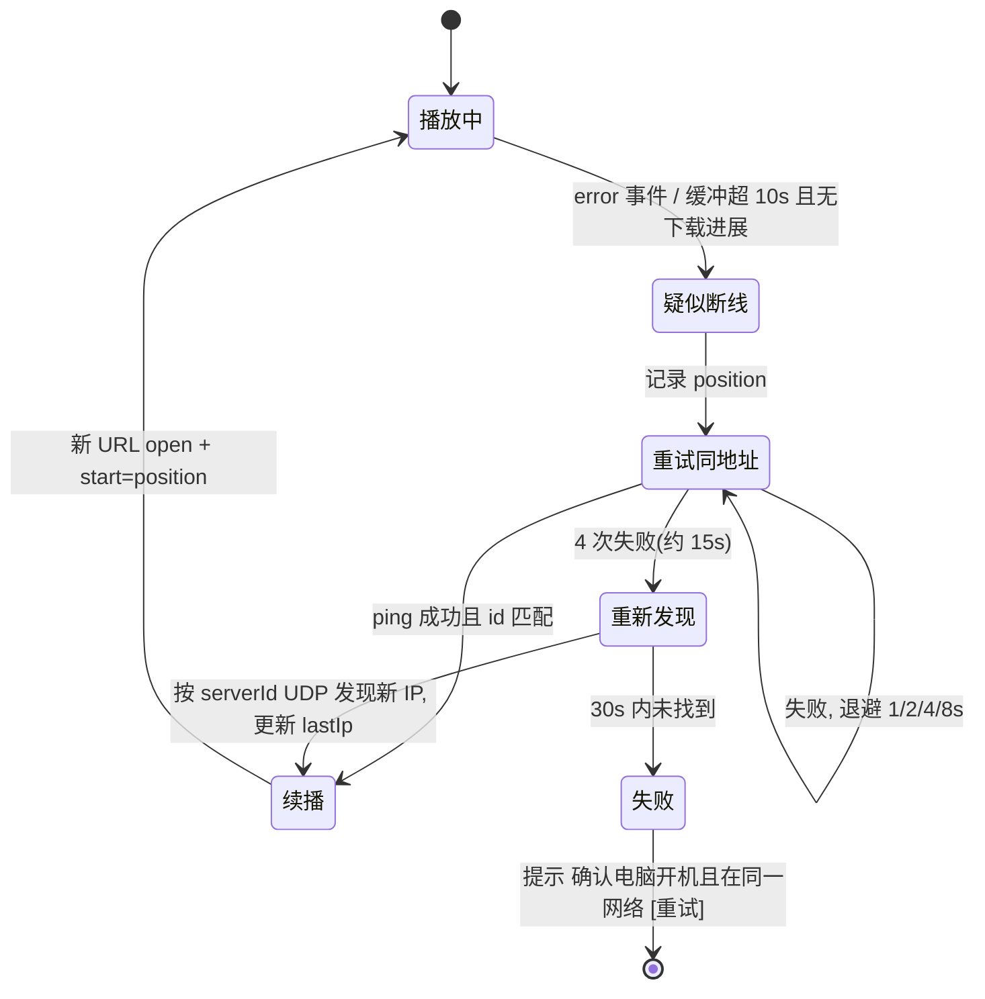

# 05 · 播放速度与稳定性

> 范围：局域网视频播放的带宽、起播/拖动速度、断线续播、电脑睡眠与手机 Wi-Fi 省电等稳定性措施。
> 前置：`/api/file`、`/api/next`、`/api/subtitles`、`/api/progress`、「不做服务端转码」见 [03-file-api.md](03-file-api.md)；断线重连、按 `serverId` 重新发现见 [01-connection.md](01-connection.md) 第 6 节。
> 分期沿用 03：P1 首版必须、P2 体验增强、P3 可选。

## 1. 卡顿来源与对策总览

| 来源 | 典型现象 | 本文对策 |
| ---- | ---- | ---- |
| 带宽不足（2.4GHz、穿墙、信道拥挤） | 缓冲转圈、缓冲秒数持续下降 | 第 2 节网络建议、测速对比 |
| 手机 Wi-Fi 省电 / 熄屏 | 播放十几分钟后突然断流 | WifiLock + 屏幕常亮（2.3） |
| 电脑睡眠 / 硬盘休眠 | 播放中途连接中断；打开文件夹首次很慢 | 阻止睡眠、预读唤醒硬盘（第 3 节） |
| 服务端写超时 | 长视频固定在某时长断开 | 不设全局 WriteTimeout（3.2） |
| 短暂断网 / IP 变化 | 报错退出播放 | 断线续播状态机（4.3） |
| 解码能力不足 | 声音正常、画面掉帧 | 硬解 + 状态面板区分（第 5 节） |

## 2. 网络

### 2.1 措施表

| 措施 | 原理 | 分期 |
| ---- | ---- | ---- |
| 推荐电脑有线接路由器、手机连 5GHz | 电脑走有线后空口只承担一跳；5GHz 实际吞吐远高于 2.4GHz 且干扰少 | P1（文档/引导页） |
| App 测速 `GET /api/speedtest` 与片源码率对比 | 先量出「能跑多快」，再与片源平均码率比较，给出明确结论 | P2 |
| 播放期间 WifiLock + 屏幕常亮 | 防止系统 Wi-Fi 省电模式降低吞吐、熄屏后断网 | P1 |

### 2.2 码率参考

| 片源 | 平均码率 | 峰值 | 2.4GHz（实际 20–50 Mbps） | 5GHz（实际 200–600 Mbps） |
| ---- | ---- | ---- | ---- | ---- |
| 1080p H.264 网络片 | 8–15 Mbps | ~25 Mbps | 基本可用，穿墙后易卡 | 充裕 |
| 1080p 蓝光原盘 | 25–40 Mbps | ~50 Mbps | 勉强/卡顿 | 充裕 |
| 4K HEVC 原盘（Remux） | 50–80 Mbps | 100+ Mbps | **不可用** | 可用（信号良好时） |

App 以 `文件大小 × 8 ÷ 时长` 估算平均码率（mpv 属性 `video-bitrate` 可作实时参考）。判定：吞吐 ≥ 1.5× 码率为「流畅」，1–1.5× 为「可能卡顿」，< 1× 为「无法流畅」。

### 2.3 测速接口 `GET /api/speedtest`（P2）

| 项 | 说明 |
| ---- | ---- |
| 参数 | `bytes`（默认 32 MiB，上限 256 MiB） |
| 响应 | `application/octet-stream`，`Cache-Control: no-store`，**不压缩**；内容为启动时生成的 1 MiB 随机块循环输出（不每次调 `crypto/rand`，避免 CPU 成为瓶颈） |
| App 计算 | 首字节到达后开始计时，取总字节 ÷ 耗时；同时测 `/api/ping` RTT 3 次取中位数 |
| 卡顿时提示 | 「当前网速约 28 Mbps，此视频约 65 Mbps，需要 5GHz Wi-Fi 或让电脑接网线」；2.4GHz 可由 `WifiInfo.getFrequency()` 判断并直接点名 |

### 2.4 手机端保活（P1）

| 手段 | 作用 | 核实结论 |
| ---- | ---- | ---- |
| `WifiManager.createWifiLock(WIFI_MODE_FULL_LOW_LATENCY, tag)` | 播放期间请求 Wi-Fi 低延迟、不进入省电 | API 29 加入；**仅在已连 AP、亮屏、App 前台时生效** |
| `WIFI_MODE_FULL_HIGH_PERF` | 旧版高性能锁 | **API 34 弃用**，会被自动替换为 LOW_LATENCY；仅 API < 29 设备用它作为回退（它在熄屏/后台也生效） |
| 屏幕常亮 `wakelock_plus` | 播放时不熄屏，同时满足 LOW_LATENCY 的「亮屏」条件 | 只用屏幕锁（`FLAG_KEEP_SCREEN_ON`），**无需权限**；不提供 CPU 锁 |
| CPU `PARTIAL_WAKE_LOCK` | 仅在将来支持后台/熄屏播音频时需要 | 本期视频前台播放不需要，不申请 |

Flutter 实现途径：`wakelock_plus` 插件 + 一个 `MethodChannel`（Kotlin，约 30 行）负责 `acquire/release` WifiLock；按 SDK 版本选择 LOW_LATENCY 或 HIGH_PERF；`setReferenceCounted(false)`；播放页 `dispose`、进入后台时释放。Manifest 声明 `WAKE_LOCK`（WifiLock 的 `acquire` 需要；以实测为准）。

## 3. 服务端

### 3.1 措施表

| 措施 | 原理 | 分期 |
| ---- | ---- | ---- |
| 保持 `ServeContent` 的 `ReadFrom` 快路径；视频不压缩 | 不经额外缓冲层；压缩视频无收益且会让播放器无法 Range 拖动 | P1 |
| 不设全局 `WriteTimeout`，流式响应单独管理期限 | 全局写超时是「整次响应」的硬期限，会切断长视频 | P1 |
| 有活跃播放时阻止系统睡眠，全部结束 N 分钟后恢复 | 电脑睡眠 = 连接中断；`SetThreadExecutionState` | P1 |
| 打开文件夹时预读唤醒机械硬盘 | 硬盘休眠后首读要 5–10 秒起转，提前在用户选片时唤醒 | P2 |

### 3.2 发送路径与「零拷贝」（核实后修正）

| 项 | 核实结论 |
| ---- | ---- |
| `ServeContent` 拷贝方式 | 内部 `io.CopyN(w, file, n)`；`w` 实现 `io.ReaderFrom` 时调用其 `ReadFrom`，进而尝试 `TCPConn.ReadFrom` → sendfile |
| Windows 上的 sendfile | 由 `TransmitFile` 实现，但**桌面/客户端版 Windows 限制全系统同时最多 2 个 TransmitFile**，第 3 个请求会卡住（golang/go#73746）。修复已合入（Go 1.25 起）：**非 Server 版 Windows 不再使用 TransmitFile**，回退为用户态缓冲拷贝 |
| 对本项目的影响 | 03 要求 Go ≥ 1.25，用户电脑多为 Win10/11 家庭版 → **实际没有零拷贝**。这是好事：多人同时播放不会被 2 并发卡死。用户态拷贝在千兆以内不构成瓶颈 |
| 包装 `ResponseWriter`（日志/统计中间件） | 包装类型若不实现 `ReadFrom`，会丢失快路径；须转发 `ReadFrom` 给内层，并提供 `Unwrap() http.ResponseWriter`，`http.NewResponseController` 依赖 `Unwrap` 找到原始 writer 才能设置期限 |
| 不压缩 | 新版 mpv 的 libcurl 后端总是声明接受压缩，服务端若对响应 gzip，mpv 会把流视为**不可拖动**。全局压缩中间件必须排除 `/api/file`、`/api/download`、`/api/speedtest` |

结论：措施保留为「**保持快路径**」（不包无 `ReadFrom` 的 writer、不压缩），不承诺零拷贝；若部署在 Windows Server 上则自动获得 TransmitFile。

### 3.3 超时策略

| 字段 | 取值 | 理由 |
| ---- | ---- | ---- |
| `ReadHeaderTimeout` | 10 s | 防慢速请求头 |
| `IdleTimeout` | 120 s | keep-alive 空闲连接回收 |
| `WriteTimeout` | **0（不设）** | 官方：从读完请求头起算的整次响应期限，且「不允许 Handler 按请求决定」→ 2 小时电影必被切断 |
| 流式响应 | 「无进展超时」：每次读文件块前用 `ResponseController.SetWriteDeadline(now+30s)` 续期 | 客户端消失（手机断网）时 30 秒内释放 goroutine 与文件句柄（否则占住移动硬盘无法弹出，见 03 §2.1） |

注意：官方说明「期限一旦已超过，再设置不会延长」，所以必须在**到期前**续期。做法是包装文件读取器（而非 writer），每次 `Read` 时续期：

```go
type deadlineReader struct {
	io.ReadSeeker
	rc *http.ResponseController
}

func (d deadlineReader) Read(p []byte) (int, error) {
	_ = d.rc.SetWriteDeadline(time.Now().Add(30 * time.Second)) // 无进展 30s 即断
	return d.ReadSeeker.Read(p)
}

// /api/file handler 中：
rc := http.NewResponseController(w) // w 为原始 writer 或可 Unwrap
http.ServeContent(w, r, name, modTime, deadlineReader{f, rc})
```

包装 `*os.File` 会让 sendfile 失效，但如 3.2 所述桌面 Windows 本就不走 sendfile，无损失；若检测到 Server 版可直接传 `*os.File` 并改用单次较长期限。

### 3.4 阻止电脑睡眠

| 项 | 设计 |
| ---- | ---- |
| API | `SetThreadExecutionState(ES_CONTINUOUS \| ES_SYSTEM_REQUIRED)`；恢复：`SetThreadExecutionState(ES_CONTINUOUS)` |
| 线程绑定 | 状态属于**调用线程**：Go 中用一个专用 goroutine `runtime.LockOSThread()` 后串行处理 acquire/release，避免 goroutine 漂移到别的 OS 线程 |
| 「活跃播放」判定 | 存在进行中的 `/api/file` 视频响应，或 60 秒内收到过 `/api/progress`（03：播放中每 10 秒上报） |
| 恢复 | 所有播放结束后 N 分钟（默认 5，管理页可改）恢复；期间又有播放则取消计时 |
| 不用的标志 | `ES_DISPLAY_REQUIRED`（无需点亮电脑屏幕）、`ES_AWAYMODE_REQUIRED`（官方建议仅媒体录制/分发且非便携设备使用，P3 可作为选项） |
| 局限（官方） | **不能阻止用户主动睡眠**（合盖、电源键、开始菜单睡眠）；不阻止屏保。管理页提示笔记本用户设置「合盖不执行操作」 |

### 3.5 预读唤醒硬盘（P2）

`/api/list` 返回含视频的目录时，后台异步读取该目录第一个视频的前 64 KiB（每卷 60 秒内最多一次，不阻塞响应）。SSD 无副作用；机械盘/移动硬盘在用户挑片的几秒内完成起转。

## 4. 播放器（media_kit / libmpv）

### 4.1 措施表

| 措施 | 原理 | 分期 |
| ---- | ---- | ---- |
| 硬件解码 | 用 MediaCodec 解 HEVC/H.264，CPU 占用低、不发热 | P1 |
| 缓存：手机 ~150 MB、低内存电视盒子 ~64 MB，预读 30–60 秒 | 吸收 Wi-Fi 抖动 | P1 |
| 断线自动续播状态机 | 短断自动恢复，用户只看到「重新连接中…」 | P1 |
| 起播：降低 probesize / analyzeduration | 减少开播前探测读取量 | P2 |
| 拖动：拖动中关键帧粗跳、松手精确跳 | 拖动时快速预览，松手位置准确 | P1 |
| 预加载下一集 | 片尾预取下一集开头与字幕 | P2 |
| 倍速 0.5–3.0× | 控制栏倍速按钮调 `Player.setRate`；切集、续播保持，退出播放器后恢复 1.0×（不持久化）。进度上报与“看完”判断都用媒体时间，不受倍速影响 | P2 |

### 4.2 libmpv 选项（核实）

设置方式：`media_kit` 常用项走 `PlayerConfiguration` / `VideoControllerConfiguration`，其余用 `(player.platform as NativePlayer).setProperty(name, value)`（底层 `mpv_set_property_string`，会等待播放器初始化）；须在 `player.open()` 之前设置。

| 选项 | 取值 | 核实说明 |
| ---- | ---- | ---- |
| `hwdec` | 保持 media_kit 默认 `auto-safe` | Android 默认 `auto-safe`、`vo=gpu`，并设 `hwdec-codecs=h264,hevc,mpeg4,mpeg2video,vp8,vp9,av1`；模拟器强制 `no`。新版 mpv 中 `auto-safe` 与 `auto` 等价。`mediacodec` 需 `vo=gpu`+`gpu-context=android` 或 `mediacodec_embed`，`mediacodec-copy` 拷回内存更兼容但更耗电；少数机型花屏时作为回退 |
| `enableHardwareAcceleration` | `true`（默认） | 官方注释：无理由勿关 |
| `demuxer-max-bytes` | 150 MiB / 64 MiB | 即 `PlayerConfiguration.bufferSize`（media_kit 默认仅 32 MB）。**注意**：4K 80 Mbps 时 150 MiB 只够约 15 秒，「60 秒预读」对原盘不成立 |
| `demuxer-max-back-bytes` | 32 MiB / 16 MiB | 回退缓存，控制总内存 |
| `cache` | `yes` | 默认 `auto` 对 http 通常已启用，显式设置更确定 |
| `demuxer-readahead-secs` / `cache-secs` | 60 | 缓存启用时实际取两者较大值，且受 `demuxer-max-bytes` 限制；`cache-secs` 默认极大 |
| `demuxer-lavf-probesize` | 1 MiB 起试（FFmpeg 默认约 5 MB） | 过小会漏识别 ts/m2ts 的后出现音轨/字幕轨；需样片回归，失败则恢复默认 |
| `demuxer-lavf-analyzeduration` | 1–2 秒 | 同上 |
| `hr-seek` | 拖动中 `no`，松手 `yes` | 默认 `default`（绝对位置跳转即精确）；media_kit 的 `seek` 为绝对跳转 |
| `network-timeout` | 15 | 默认 60 秒，断线发现过慢 |
| `stream-lavf-o` | `reconnect=1,reconnect_streamed=1,reconnect_on_network_error=1,reconnect_delay_max=5` | 仅当 libmpv 使用 **FFmpeg 网络栈**时有效；未知选项静默忽略 |

> **冲突说明**：mpv 新版本在编译含 libcurl 时，http 由内置 libcurl 后端处理（默认 `curl-enabled=yes`），此时 `stream-lavf-o` 的 reconnect 参数**不生效**，对应能力为 `--curl-max-retries`（默认 5，可透明重试可 Range 的传输）。media_kit 打包的 libmpv 版本以实测为准（`mpv-version` 属性），两组都设，不冲突。无论哪种，播放器内部重试只覆盖秒级抖动，长断线靠 4.3 状态机。

### 4.3 断线自动续播（P1）

与 01 §6「运行中断线：指数退避重试数次后再走重连流程」一致，在播放层细化：



| 要点 | 说明 |
| ---- | ---- |
| UI | 状态机运行期间只显示半透明「重新连接中…」，不弹错误框；失败后才显示 01 §6 的提示与「重试」 |
| 断点 | App 内存中每秒记录 `position`（不依赖每 10 秒的 `/api/progress`），续播误差 ≤ 1–2 秒 |
| 续播方式 | 用新地址重建 `/api/file?...&t=` URL，`open` 前 `setProperty('start', '<秒>')`，避免先从 0 播放再跳 |
| 401 | 不重试，直接走 01 的重新配对 |
| 网络切换 | 监听 Android 网络变化（Wi-Fi 重连）时立即进入「重试同地址」，跳过剩余退避 |

### 4.4 预加载下一集（P2）

| 步骤 | 说明 |
| ---- | ---- |
| 触发 | 剩余时长 ≤ 2 分钟时调用 `/api/next`、`/api/subtitles`（03 §4.6/4.7） |
| 预取 | 对下一集 `/api/file` 发 `Range: bytes=0-8388607`（约 8 MB）；字幕整文件下载到本地临时目录（App 现状：未预取字幕，切到下一集时再请求 `/api/subtitles`，字幕以 `/api/file?t=` 直链交给 mpv） |
| 实际收益 | App 下载的这 8 MB **无法直接喂给 mpv**（不引入本地代理）；收益在于：唤醒电脑硬盘、进入电脑系统文件缓存、提前验证可达。下一集起播时读取命中服务端缓存 |
| 替代（待评估） | mpv `prefetch-playlist=yes` + media_kit `Playlist`，由 mpv 自己预取并复用；官方标注为实验性，与自定义「下一集」逻辑耦合，暂不采用 |

### 4.5 播放器滑动手势（P2）

纯函数在 `app/lib/services/player_gestures.dart`（有单元测试），亮度 / 音量经 `MainActivity` 的 MethodChannel（`getBrightness` `setBrightness` `getVolume` `setVolume`）。

| 项 | 规则 |
| ---- | ---- |
| 方向判定 | 越过拖动阈值（Flutter `kPanSlop` 18dp）后按累计位移定一次：横向位移 ≥ 纵向为拖动进度，否则纵向；纵向按**起点**在左半屏 / 右半屏区分亮度 / 音量。本次手势中途不改类别 |
| 边缘 | 起点距屏幕任一边 < 24dp 不响应：左右避开系统返回手势，上下避开状态栏 / 导航栏下拉 |
| 拖动进度 | 整屏宽 = 90 秒（片长不足 90 秒时整屏宽 = 全片），目标限制在 0…片长；拖动中屏幕中央显示“目标 / 总长”与相对变化（如 `12:34 / 45:12`、`+01:30`），控制栏可见时进度条同步；**松手才跳转**。片长未知时不响应 |
| 亮度（左半屏） | 上滑整屏高 = +100%。只改本 App 窗口 `WindowManager.LayoutParams.screenBrightness`（下限 0.01），不改系统设置、无需权限；起点取窗口当前值，未设置时取系统亮度 ÷ 255 近似；离开播放器恢复跟随系统（`BRIGHTNESS_OVERRIDE_NONE`） |
| 音量（右半屏） | 上滑整屏高 = +100%，`AudioManager.STREAM_MUSIC` 按最大档位取整，`flags = 0` 不弹系统音量条，屏幕中央显示自己的指示条；音量是系统设置，离开播放器不恢复 |
| 与其他操作 | 单击仍切换控制栏（移动未超阈值时为单击）；控制栏、进度条、按钮区域位于手势层之上，触摸不会落到手势层；片尾“下一集”卡片、选集抽屉、连接失败面板显示时整个手势不响应。无双击手势 |
| 横竖屏 | 都按当前屏幕尺寸计算 |

## 5. 格式兼容

| 措施 | 原理 | 分期 |
| ---- | ---- | ---- |
| 播放状态面板 | 区分「网络问题」与「解码问题」，用户/反馈可据此判断 | P2 |
| 可选服务端实时转码（ffmpeg + NVENC/QSV/AMF） | 对极老设备或超高码率片源降码率 | P3 |

状态面板字段（mpv 属性，通过 `NativePlayer.getProperty` 每秒轮询，名称以实测为准）：

| 显示 | 属性 | 判读 |
| ---- | ---- | ---- |
| 码率 | `video-bitrate`、`audio-bitrate` | 与 2.3 测速对比 |
| 缓冲秒数 / 下载速度 | `demuxer-cache-duration`、`cache-speed` | 缓冲持续下降 → **网络**问题 |
| 是否为缓冲暂停 | `paused-for-cache` | |
| 硬解 / 软解 | `hwdec-current`（`no` 即软解） | 软解 + 丢帧 → **解码**问题 |
| 丢帧 | `frame-drop-count`、`decoder-frame-drop-count` | 缓冲充足仍持续增长 → 解码能力不足 |

**关于转码（P3）**：这是对 03 §6「不做服务端转码」的**后期可选补充**，不改变其默认决策——默认仍原样输出；仅当管理页开启且检测到 ffmpeg 与可用硬件编码器（NVENC/QSV/AMF）时，App 才在状态面板判定为「解码问题」或「带宽不足」后提供「降码率播放」入口。转码流不可任意精确拖动、单路占用 GPU，服务端同时最多 1 路。

## 6. 优先级小结

性价比最高的 4 项（实现量小、对「播着播着断了」类问题覆盖最大）：

| # | 措施 | 分期 | 解决 |
| ---- | ---- | ---- | ---- |
| 1 | 阻止电脑睡眠（3.4） | P1 | 电脑按电源计划睡眠导致中途断开 |
| 2 | WifiLock + 屏幕常亮（2.4） | P1 | 手机 Wi-Fi 省电降速 / 断流 |
| 3 | 断线自动续播（4.3） | P1 | 路由器抖动、IP 变化后需手动重开 |
| 4 | 预加载下一集（4.4） | P2 | 连续追剧时下一集起播慢（硬盘休眠） |

## 7. 验收测试

| # | 场景 | 期望 |
| ---- | ---- | ---- |
| 1 | 播放中关闭路由器 Wi-Fi 30 秒后恢复 | 自动续播，仅显示「重新连接中…」，进度误差 < 5 秒 |
| 2 | 播放中电脑更换 IP（DHCP 改绑后重连） | 按 serverId 重新发现并续播，`lastIp` 更新 |
| 3 | 电脑电源计划设 1 分钟睡眠，连续播放 10 分钟 | 不睡眠；停止播放 N 分钟后正常睡眠 |
| 4 | 播放 2 小时以上影片 | 不在固定时长被断开（验证无 WriteTimeout） |
| 5 | 3 台设备同时播放同一电脑上的不同视频（Win11 家庭版） | 均正常起播，无第 3 路卡住（验证 3.2） |
| 6 | 播放中手机拔掉网络 | 服务端 30 秒内释放连接与文件句柄，移动硬盘可安全弹出 |
| 7 | 手机连 2.4GHz 播放 4K HEVC 原盘 | 测速后给出「需要 5GHz/有线」的明确提示 |
| 8 | 手机熄屏前后、播放 30 分钟 | 不熄屏、不断流；退出播放页后 WifiLock 已释放 |

## 8. 待确认问题

| # | 问题 | 建议 |
| ---- | ---- | ---- |
| 1 | 恢复睡眠的等待时长 N | 默认 5 分钟，管理页可调 |
| 2 | media_kit 打包的 libmpv 走 FFmpeg 还是 libcurl 网络栈 | P1 开发首周读取 `mpv-version` 与日志确认，决定 4.2 重连参数以哪组为主 |
| 3 | 电视盒子判定「低内存」的阈值 | `ActivityManager.isLowRamDevice()` 或总内存 ≤ 2 GB 用 64 MB 档 |

## 9. 看图加载（App）

服务端接口见 03 §4.5（`/api/thumb` 的预览档位与 `ver` 缓存版本）。

| 环节 | 做法 |
| ---- | ---- |
| 文件夹网格 / 列表 | 缩略图按格子物理像素（逻辑宽 × 像素比）取 160/320/640 档（`thumbWidthFor`） |
| 渐进加载 | 打开某张图：立即显示内存或磁盘里已有的列表缩略图（大档优先）作底图 → 请求预览图（`w` = 屏幕物理像素长边向上取 1280/1920/2560 档）到达后淡入替换 → 放大到“显示物理宽度 > 预览图宽度 × 1.2”且预览图确被缩小过（长边达到请求档位）时才加载原图 `/api/file`（解码上限 4096），到达后淡入替换。加载中顶部 2 px 进度条；什么都没有时居中转圈。服务端不能生成缩略图的图片（`hasThumb=false`）直接加载原图 |
| 预取 | 当前图的预览图显示（或失败）后，预取后 1、前 1、后 2、前 2 张的预览图；翻页时取消排队中已不需要的预取 |
| 请求队列 | `FetchQueue`：缩略图并发 4、看图（预览 / 原图）并发 3，同键去重；正在显示的条目优先出队，滑出屏幕 / 翻走后取消其**排队中**的请求（已开始的不中断） |
| 连接 | 图片请求共用一个 `HttpClient`（keep-alive 复用，每台电脑最多 6 条连接） |
| 磁盘缓存 | `flutter_cache_manager`，按条目数上限 + 最近访问时间淘汰（LRU）：缩略图 6000 条（约 200 MB）、预览图 400 条（约 250 MB）。缓存键 = 去掉 `t` 的 URL（含 `w`、`ver`）+ `#mtime`，token 变化不失效；磁盘命中直接用，不再请求（键已含版本，内容不会变）。原图不落盘，只进内存 |
| 加密片库 | 缩略图、预览图、原图一律只进 Flutter 内存图片缓存，不读写磁盘缓存（04 §8）；上锁时清空内存图片缓存 |
