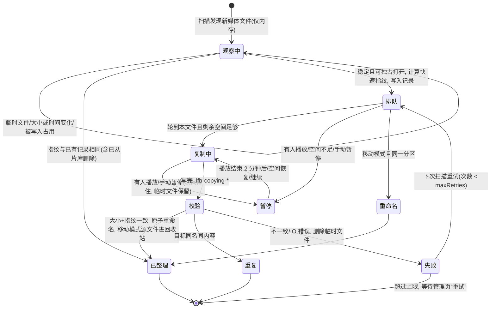

# 06 · 自动整理（整理库）

> 范围：为片库（共享）开启“自动整理”：服务端定时扫描一个或多个源文件夹（如下载目录）中下载完成的视频/图片，自动归类复制或移动到该片库目录；手机/电视只读片库。
> 前置：共享模型（`shareId`、权限、可见手机）、路径安全、SQLite（`data.db`）、回收站删除、上传“临时文件 + 原子重命名”见 [03-file-api.md](03-file-api.md)；活跃播放跟踪见 [05-playback.md](05-playback.md) §3.4；加密片库见 [04-vault.md](04-vault.md)。
> 不含：实现代码。

## 1. 目的与原理

| 项 | 说明 |
| ---- | ---- |
| 问题 | BT、浏览器等下载软件大量读写某块硬盘时，从同一块盘播放会因磁头争用/队列拥塞而卡顿 |
| 做法 | 片库目录放在**另一块物理硬盘**；下载完成的文件由服务端在空闲时复制过去，播放只读片库所在盘 |
| 片库即共享 | 自动整理是**片库（共享）自身的一项设置**，不是独立的全局规则；该片库的目录就是整理的目标目录（下称“库目录”）。可见手机、下载/上传/删除权限、加密片库照常适用 |
| 同盘提醒 | 源文件夹与库目录在同一块物理盘时，管理页明确提示：“两者在同一块硬盘上，整理后播放仍会与下载争用同一块盘，无法解决卡顿”。同一分区且选“移动”时直接重命名（瞬间完成） |

同盘判定：按卷取所在物理磁盘号（`IOCTL_VOLUME_GET_VOLUME_DISK_EXTENTS`），磁盘号相同即同盘（同一硬盘的 D:、E: 两个分区也算同盘）；同一卷（卷序列号相同）才能重命名。

## 2. 术语

| 术语 | 含义 |
| ---- | ---- |
| 片库 / share | 03 中的共享文件夹，以 `shareId` 标识 |
| 库目录 | 开启自动整理的片库的真实路径 |
| 源文件夹 / source | 该片库下配置的被扫描目录，可多个，每个单独选“复制/移动” |
| 整理记录 | SQLite 中每个源文件的一行记录（第 6 节） |
| 快速指纹 | `文件大小 + SHA-256(前 1 MiB ‖ 后 1 MiB)`，小于 2 MiB 的文件对整个文件做哈希 |

## 3. 配置（共享配置中的 `organize`）

在 03/04 的共享配置上增加 `organize` 字段；数值字段为 `null` 时使用全局默认值（管理页“设置”中统一修改）。

| 字段 | 说明 | 全局默认 |
| ---- | ---- | ---- |
| `enabled` | 是否开启自动整理 | — |
| `sources[]` | `{id, path, mode, afterMove}`；`id` 为短随机 ID（状态按它归属），`mode` 为 `copy` / `move`；`afterMove`（仅移动模式）为 `recycle`（移入回收站）/ `delete`（直接删除） | `afterMove`: `recycle` |
| `interval` | 扫描间隔（分钟） | 30 |
| `rateLimit` | 复制限速（MB/s，0 = 不限） | 50 |
| `minFree` | 库盘最小剩余空间（GB，`null` 时取“总容量 10% 与 20 GB 的较小值”） | 10% / 20 GB 取小 |
| `maxRetries` | 单文件失败重试上限 | 3 |
| `paused` | 手动暂停（重启后保持） | false |
| `pauseOnPlay` | 播放时暂停复制（仅当播放文件与复制涉及的硬盘相同时暂停，见第 8 节） | true |

```json
{
  "shareId": "k3f9q2ma",
  "name": "影视库",
  "path": "E:\\Library",
  "organize": {
    "enabled": true,
    "sources": [
      { "id": "s1a2", "path": "D:\\Downloads\\BT", "mode": "copy" },
      { "id": "s3b4", "path": "D:\\Downloads\\Browser", "mode": "move", "afterMove": "recycle" }
    ],
    "interval": null, "rateLimit": 30, "minFree": null, "maxRetries": null, "paused": false
  }
}
```

- 新建片库时可勾选“作为自动整理库”：库目录不存在则自动创建，并直接进入源文件夹设置。
- 关闭 `enabled` 只停止扫描，不删除已整理的文件与整理记录。

## 4. 扫描与“下载完成”判定

### 4.1 扫描

| 项 | 设计 |
| ---- | ---- |
| 触发 | 每个片库按自身 `interval` 定时；管理页“立即扫描”；服务启动后 1 分钟首扫 |
| 并发 | 同一片库的扫描与复制串行；不同片库可并行扫描，但**复制全局同一时刻只有 1 个文件**（防多路并发抢盘） |
| 遍历 | 递归遍历每个源文件夹，只做 `Lstat`，不读内容；跳过 03 §2.4 的始终隐藏项、隐藏文件与 `.lfb-*` |
| 离线 | 库目录不存在（硬盘未连接）→ 本次跳过，状态“片库离线”；某源文件夹不存在 → 只跳过该源 |
| 不处理 | 非媒体文件（压缩包、.nfo、.torrent 等）原地不动 |

| 类型 | 扩展名（大小写不敏感） |
| ---- | ---- |
| 视频 | mp4 m4v mkv webm avi mov wmv flv ts m2ts mts rmvb 3gp |
| 图片 | jpg jpeg png gif webp heic heif bmp |
| 字幕（只跟随视频，见 5.3） | srt ass ssa vtt |

### 4.2 下载完成判定（全部满足才入队）

| # | 条件 | 说明 |
| ---- | ---- | ---- |
| 1 | 不是临时文件 | 扩展名为 `.part .!qB .td .downloading .crdownload .aria2 .tmp` 的跳过；存在同名 `<文件名>.aria2` 的文件也跳过（aria2 下载中） |
| 2 | 两次扫描间稳定 | 本次与上次扫描的大小、修改时间都相同（观察状态只放内存，重启后需再扫一次；“立即扫描”与上次扫描间隔不足 1 分钟时，先等满 1 分钟再比对） |
| 3 | 能以“拒绝写共享”打开 | `CreateFile(GENERIC_READ, FILE_SHARE_READ)`（不含 `FILE_SHARE_WRITE`）；若其他进程持有写句柄则返回共享冲突，视为仍在写入。打开成功即关闭 |

> 以实测为准：部分 BT 客户端做种时仍以读写方式持有文件，条件 3 会一直不满足。若文件已稳定超过 24 小时仍被占用，状态列表显示“被其他程序占用（可能在做种）”，提示用户在下载软件中把做种文件设为只读，或改用“复制”并暂停该任务做种。

## 5. 自动归类

### 5.1 规则（按顺序取第一个命中）

| # | 类别 | 识别 | 目标（相对库目录） |
| ---- | ---- | ---- | ---- |
| 1 | 照片 | 图片文件 | `照片/<年>/<月>/原文件名`；时间取 EXIF `DateTimeOriginal`；无则取文件名中的日期（`YYYYMMDD` 或 `YYYY-MM-DD` / `YYYY_MM_DD`，前后不接数字且须为合法日期，如 `IMG_20250314_101010`、`PXL_20250314_…`、`Screenshot_2025-03-14…`）；再无则取修改时间 |
| 2 | 手机短视频 | 相机命名：`VID_`、`MVIMG_`、`PXL_`、`IMG_`（.mov/.mp4）、`VID-YYYYMMDD-WA` 等 | 同照片；时间取文件名中的日期，无则修改时间 |
| 3 | 剧集 | 见 5.2 | `剧集/<剧名>/第<季>季/原文件名` |
| 4 | 电影 | 其他视频，名称规范化后非空 | `电影/原文件名`；识别出年份时 `电影/<名称> (<年份>)/原文件名` |
| 5 | 未分类 | 规范化后无可用名称（如下载根目录下的 `12.mp4`） | `未分类/原文件名` |

### 5.2 剧集识别

| 模式 | 示例 | 剧名来源 |
| ---- | ---- | ---- |
| `S(\d+)E(\d+)` | `Show.Name.S01E02.1080p.mkv` | `S01E02` 之前的部分 |
| `[组] 剧名 - 02 [...]` | `[字幕组] 剧名 - 02 [1080p].mkv` | 去掉 `[组名]` 后 ` - 集号` 之前 |
| `第(\d+)[集话話]` | `剧名 第02集.mp4` | 集号之前 |
| `EP?(\d+)` | `剧名 EP02.mp4` | 集号之前 |
| 只有集号 | `进击的巨人/12.mkv`、`某剧/第12集.mp4`、`[02].mkv` | **父文件夹名**（父文件夹即源文件夹根时归“未分类”） |

| 处理 | 规则 |
| ---- | ---- |
| 剧名规范化 | 点、下划线转空格；去掉 `[...]`/`【...】` 组名；去掉分辨率（`1080p` `2160p` `4K`）、编码（`x264` `x265` `HEVC` `AVC` `10bit`）、来源（`WEB-DL` `BluRay`）等标签；合并空白、去首尾空格与 `-` |
| 季 | `S02`、`第二季`、`Season 2` 出现在文件名或父文件夹名时取之，**默认 1** |
| 目录名安全 | 剧名/电影名作为目录名前按 03 §2.2 规则清洗：非法字符替换为空格、去结尾点与空格、保留设备名加后缀 `_`、单段截断到 255 字符 |
| 共用解析 | 集号解析与 03 §4.6“下一集”**共用同一个解析模块**（`internal/episode`），排除 `1080p`、`x265`、年份等干扰数字的规则只维护一份 |

### 5.3 字幕跟随与重名

| 项 | 规则 |
| ---- | ---- |
| 字幕跟随 | 与视频同目录、同主名的字幕（含语言后缀，如 `E02.chs.srt`、`E02.zh-CN.ass`）在视频整理完成后，复制/移动到视频目标目录，并沿用视频的最终主名（视频因重名变为 `E02 (1).mkv` 时字幕改为 `E02 (1).chs.srt`） |
| 字幕后到 | 视频已整理、字幕之后才下载完成：扫描时按“同源目录 + 同主名”查到已整理的视频记录，字幕跟随到该目标 |
| 孤立字幕 | 找不到对应视频的字幕不处理 |
| 目标重名 | 目标已存在：大小与快速指纹相同 → 记为“重复”，不复制（“移动”模式下源文件照常进回收站）；不同 → 按 03 §4.9 加 ` (1)`、` (2)`… |

## 6. 状态与去重



SQLite 表 `organize_items`（同 03 的 `data.db`）：

| 字段 | 说明 |
| ---- | ---- |
| `id` | 自增主键 |
| `share_id` / `source_id` | 所属片库 / 源文件夹 |
| `src_path` / `src_key` | 源相对路径（相对源文件夹）/ 其 `strings.ToLower` 结果（同 03 `path_key` 做法） |
| `size` / `mtime` / `fingerprint` | 入队时的大小、修改时间、快速指纹 |
| `kind` / `category` | `video` `image` `subtitle` / `photo` `episode` `movie` `unsorted` |
| `target_path` | 库目录内相对路径（最终名） |
| `state` | `queued` `copying` `done` `duplicate` `failed` |
| `source_action` | `kept`（复制）`recycled` `deleted`（`afterMove: delete`）`renamed` `recycle_failed` |
| `attempts` / `error` | 失败次数 / 最近一次错误（可读文字） |
| `created_at` / `updated_at` / `done_at` | 时间 |

唯一键 `(share_id, source_id, src_key, fingerprint)`。

| 规则 | 设计 |
| ---- | ---- |
| 不重复整理 | 存在 `done`/`duplicate` 记录即跳过——**即使用户之后在片库里删掉了该文件**（记录不随片库文件删除而清除） |
| 快速跳过 | 同路径记录的大小、mtime 与当前一致 → 直接跳过，不重新读文件算指纹 |
| 同路径新内容 | 大小或 mtime 变化 → 重新走观察流程；稳定后指纹不同 → 新记录（视为新文件），相同 → 更新 mtime 后跳过 |
| 重启 | `copying` 记录重启后改回 `queued`；启动时清理各库目录中残留的 `.lfb-copying-*` |
| 重新整理 | 管理页可对单条记录“重新整理”（删除该记录，下次扫描按新文件处理） |

## 7. 复制过程

| 步骤 | 说明 |
| ---- | ---- |
| 1 目标 | 按第 5 节算出目标目录，经库目录的 `os.Root` 创建（`MkdirAll` 语义逐级创建），所有写操作都在库目录 `os.Root` 内进行 |
| 2 临时文件 | 目标目录下 `.lfb-copying-<随机>`（`O_CREATE\|O_EXCL`），与 03 §4.9 上传临时文件同法；需加入 03 §2.4“始终隐藏”名单，App 看不到 |
| 3 复制 | 1 MiB 分块读写，每块之间检查限速、播放暂停、手动暂停（第 8 节）；写完 `Sync` |
| 4 校验 | 临时文件大小、快速指纹与入队记录一致；且源文件大小、mtime 未变（复制期间被改动 → 丢弃临时文件，回到观察中） |
| 5 落盘 | 设置临时文件修改时间为源文件原 mtime；选定最终名（重名规则 5.3，按目录加锁）后 `root.Rename` 原子重命名 |
| 6 源处理 | 复制模式：不动源文件，不影响做种。移动模式：按 `afterMove` 处理——`recycle`：移入回收站（`SHFileOperationW` + `FOF_ALLOWUNDO`；事先确认源盘为固定磁盘、未设“不移到回收站”且文件不超过回收站容量，否则视为无回收站），源盘无回收站时**保留源文件**，记 `recycle_failed` 并提示，不自动改为永久删除；`delete`：校验通过后直接永久删除源文件 |
| 同分区移动 | 跳过 2–5，直接 `MoveFileEx` 重命名到最终名（瞬间完成、原子，mtime 自然保留） |
| 失败 | 删除临时文件，`attempts+1`，记录 `error`；下次扫描重试，达到 `maxRetries` 后停止，等待管理页“重试” |

## 8. 防卡顿（核心目的）

| 措施 | 设计 | 默认 |
| ---- | ---- | ---- |
| 复制限速 | 令牌桶，按块取令牌；每个片库可单独设置 | 50 MB/s |
| 有人播放时暂停 | 由片库的 `pauseOnPlay` 开关控制（默认开）。复用 05 §3.4 的“活跃播放”判定（存在进行中的 `/api/file` 视频响应，或 60 秒内收到过 `/api/progress`）。**仅当正在播放的文件与本次复制涉及的硬盘（源盘或库盘）是同一块物理盘时才暂停**，播放其他硬盘上的文件不影响复制，避免长时间追剧导致新文件一直不入库。暂停时复制在当前块结束后停住（临时文件与句柄保留，不重来）；扫描与“观察中”比对照常进行 | 相关播放全部结束 2 分钟后继续 |
| 降低 IO 优先级 | 复制在专用 goroutine 中 `runtime.LockOSThread()` 后调用 `SetThreadPriority(GetCurrentThread(), THREAD_MODE_BACKGROUND_BEGIN)`，使该线程的磁盘 IO 与内存优先级降为后台级；结束时 `THREAD_MODE_BACKGROUND_END`。**效果以实测为准**（与 BT 客户端争用时的实际收益需验证） | 开 |
| 剩余空间 | 每个文件复制前检查：`库盘剩余 − 文件大小 ≥ minFree`，不足则该片库暂停，管理页提示“片库所在硬盘空间不足（剩余 x GB，需保留 y GB）”；下次扫描时自动复查 | 10% 与 20 GB 取小 |
| 单路复制 | 全局同一时刻只复制 1 个文件（4.1） | — |
| 不缓存污染（可选） | 读源文件时用顺序读提示（`FILE_FLAG_SEQUENTIAL_SCAN`），减少挤占系统文件缓存中正在播放的数据；以实测为准 | 开 |

暂停原因按优先级显示：手动暂停 > 空间不足 > 正在播放。

## 9. 安全

| 规则 | 设计 |
| ---- | ---- |
| 仅本机设置 | 开启整理、源文件夹路径、模式只能在本机管理页设置（接口仅 127.0.0.1，第 11 节）；App 无任何整理接口 |
| 防循环整理 | 保存时校验（真实路径规范化后、大小写不敏感、按分隔符边界比较）：库目录不能是任何源文件夹的子目录，源文件夹也不能是库目录的子目录或相同目录；**跨片库同样校验**（A 片库的库目录不能位于 B 片库的源文件夹内；只涉及配置了源文件夹的片库，普通共享不参与） |
| 源文件夹互斥 | 同一源文件夹（或其子目录）不能同时被两个片库/两个源配置，避免一个文件被整理两次 |
| 不跟随链接 | 遍历源文件夹时遇到符号链接、目录联接（重解析点）一律跳过，不跟随 |
| 写入范围 | 目标只写在库目录 `os.Root` 内；目标名经 5.2 清洗 |
| 加密片库 | 库目录可以是加密片库（04）；整理日志对加密片库只记 `shareId` 与状态，不记文件名/路径（同 04 §7 #10）。管理页为可信端，状态列表正常显示文件名 |

## 10. 管理页（片库设置 → 自动整理）

| 区域 | 内容 |
| ---- | ---- |
| 开关 | “自动整理”开关；开启后展开以下内容。片库列表中已开启的片库显示“自动整理”标记与当前状态 |
| 源文件夹 | 列表：路径（浏览选择）、复制/移动（单选，附说明：“复制：保留源文件，不影响做种”“移动：复制并校验后处理源文件”，移动时再选“移入回收站（默认）/ 直接删除”，选直接删除时提示“删除后无法从回收站恢复”）、删除；可添加多个。同盘时该行显示黄色提醒（第 1 节文案） |
| 参数 | 扫描间隔、限速、最小剩余空间、重试次数；留空 = 使用全局默认（显示默认值作为占位） |
| 状态 | 状态（空闲 / 扫描中 / 复制中 x% · y MB/s / 已暂停：原因 / 片库离线）、上次扫描时间、下次扫描时间；计数：已整理、重复、队列中、观察中、失败 |
| 操作 | 立即扫描、试运行、暂停/继续 |
| 试运行 | 列出“哪个文件会被整理到哪里”：源文件、类别、目标路径、动作（复制/移动/重命名/重复跳过/下载中暂不整理/被占用）；**不复制、不写记录**，供用户确认规则 |
| 失败与记录 | 失败列表（文件名、原因、次数，单条/全部“重试”）；最近整理记录（时间、源 → 目标），支持“重新整理” |
| 全局设置 | “设置”页增加自动整理默认值：间隔、限速、最小剩余空间、重试次数 |

## 11. 接口（仅 127.0.0.1）

与 01 的 `/api/devices` 相同，仅允许本机访问，非本机一律 404。

| 方法 | 路径 | 说明 |
| ---- | ---- | ---- |
| GET | `/api/admin/shares/{id}/organize` | 返回 `{organize, defaults, sources: [{id, sameDisk, sameVolume}], status}`（配置、全局默认值、各源的同盘提醒、状态）；PUT 与暂停/继续返回同样内容 |
| PUT | `/api/admin/shares/{id}/organize` | 整体保存配置（第 3 节字段）；按第 9 节校验，失败 `400 BAD_PATH` / `409 CONFLICT`（与其他片库源文件夹重叠） |
| POST | `/api/admin/shares/{id}/organize/scan` | 立即扫描，`202` |
| POST | `/api/admin/shares/{id}/organize/dry-run` | 试运行，返回 `items[]` |
| POST | `/api/admin/shares/{id}/organize/pause` · `/resume` | 手动暂停/继续（写入 `paused`） |
| GET | `/api/admin/shares/{id}/organize/items` | 整理记录，参数 `state`、`offset`、`limit` |
| POST | `/api/admin/shares/{id}/organize/items/retry` | Body `{ids: []}`，失败记录清零重试次数后回到排队 |
| DELETE | `/api/admin/shares/{id}/organize/items/{itemId}` | 删除记录 = “重新整理” |
| GET/PUT | `/api/admin/organize/defaults` | 全局默认值 |
| POST | `/api/admin/organize/check-path` | Body `{sharePath, sourcePath}`，返回 `{sameDisk, sameVolume, nested}`，供管理页即时提示 |

| 状态字段 | 说明 |
| ---- | ---- |
| `state` | `idle` `scanning` `copying` `paused` `offline` |
| `pauseReason` | `manual` `lowSpace` `playback` |
| `lastScanAt` / `nextScanAt` | RFC 3339 |
| `counts` | `{done, duplicate, queued, watching, failed}`；`bySource` 按 `sources[].id` 分组（不含 `watching`） |
| `current` | `{name, bytes, total, speed}` 或 `null` |
| `freeBytes` / `minFreeBytes` | 库盘剩余 / 需保留 |

试运行 `items[]`：`{sourceId, srcPath, category, targetPath, action, note}`，`action` 为 `copy` `move` `rename` `duplicate` `waiting` `locked` `done`；最多返回 500 条，另给 `total`。

## 12. 分期与需同步更新

**分期**：建议 **P2**。依赖 03 的共享模型、`os.Root` 路径安全、SQLite（`data.db`）与回收站删除；依赖 05 §3.4 的活跃播放跟踪。归类识别器与 03 §4.6“下一集”的集号解析**共用同一解析模块**，应先于或同时实现。

| 需同步更新 | 内容 |
| ---- | ---- |
| 管理页设计 v5（v5-home-theater.html） | 片库设置中新增“自动整理”区（第 10 节）；片库列表加“自动整理”标记与状态；“设置”页加自动整理默认值；新建片库时“作为自动整理库”选项 |
| desgin/brief.md | 共享配置补充 `organize` 字段 |
| README.md | 功能规划表加“P2 自动整理（下载目录 → 另一块硬盘的片库）”；设计文档表加 06-organizer |
| 03-file-api.md | §2.4“始终隐藏”名单增加 `.lfb-copying-*`；§4.6 注明集号解析模块与本文共用 |

## 13. 已确认决策

| # | 问题 | 结论 |
| ---- | ---- | ---- |
| 1 | “移动”模式下源文件的处理 | 每个源文件夹可选：移入回收站（默认）/ 直接删除 |
| 2 | “有人播放时暂停”的范围 | 仅当播放文件与复制涉及的硬盘相同时暂停；每个片库可用 `pauseOnPlay` 开关关闭 |
